# TLS 1.3 – Tài liệu nghiên cứu chuyên sâu về cơ chế

> **Trạng thái:** bản nháp để review.
> **Phạm vi:** TLS 1.3, Full Handshake có xác thực server bằng Certificate, trao đổi khóa bằng ECDHE tạm thời, cipher suite `TLS_AES_128_GCM_SHA256`.
> **Độ sâu:** giải thích cơ chế (ai tạo gì, dùng khóa nào, truyền gì, vì sao cần), **không** giải thích bên trong thuật toán mã hóa (không có vòng AES, toán GHASH, toán đường cong elliptic).

---

## Mục lục

- [Giới thiệu và mục tiêu](#giới-thiệu-và-mục-tiêu)
- [Quy ước và bảng phân biệt thuật ngữ](#quy-ước-và-bảng-phân-biệt-thuật-ngữ)
- [Chương 1. Tổng quan TLS và các cơ chế mật mã](#chương-1-tổng-quan-tls-và-các-cơ-chế-mật-mã)
- [Chương 2. ECDHE và Shared Secret](#chương-2-ecdhe-và-shared-secret)
- [Chương 3. Certificate và xác thực server](#chương-3-certificate-và-xác-thực-server)
- [Chương 4. Transcript Hash và CertificateVerify](#chương-4-transcript-hash-và-certificateverify)
- [Chương 5. Finished và toàn vẹn Handshake](#chương-5-finished-và-toàn-vẹn-handshake)
- [Chương 6. HKDF và Key Schedule](#chương-6-hkdf-và-key-schedule)
- [Chương 7. TLS Record, Static IV và Nonce](#chương-7-tls-record-static-iv-và-nonce)
- [Chương 8. AES-GCM, AEAD, AAD và Authentication Tag](#chương-8-aes-gcm-aead-aad-và-authentication-tag)
- [Chương 9. MITM và Forward Secrecy](#chương-9-mitm-và-forward-secrecy)
- [Chương 10. KeyUpdate](#chương-10-keyupdate)
- [Chương 11. TLS 1.3 Full Handshake end-to-end](#chương-11-tls-13-full-handshake-end-to-end)
- [Chương 12. Những hiểu lầm thường gặp](#chương-12-những-hiểu-lầm-thường-gặp)
- [Chương 13. Ứng dụng trong Infrastructure (phần mở rộng)](#chương-13-ứng-dụng-trong-infrastructure-phần-mở-rộng)
- [Tổng kết](#tổng-kết)
- [Câu hỏi kiểm tra tổng hợp](#câu-hỏi-kiểm-tra-tổng-hợp)
- [Thuật ngữ](#thuật-ngữ)
- [Tài liệu tham khảo](#tài-liệu-tham-khảo)
- [Phụ lục A. Đối chiếu với RFC 8446](#phụ-lục-a-đối-chiếu-với-rfc-8446)

---

## Giới thiệu và mục tiêu

Tài liệu này hệ thống hóa những gì đã tìm hiểu về TLS 1.3 thành một mạch kiến thức liên tục: từ vì sao cần TLS, qua từng cơ chế mật mã, đến toàn bộ quá trình Full Handshake và các nguy cơ bảo mật.

**Sau khi đọc, người đọc có thể:**

1. Giải thích mỗi cơ chế mật mã trong TLS 1.3 làm gì và vì sao nó cần tồn tại.
2. Nói rõ dữ liệu và khóa nào được tạo ra, ở đâu, dùng vào việc gì, và cái nào được truyền hay **không** được truyền qua mạng.
3. Mô tả chính xác trình tự Full Handshake và thời điểm mỗi bên xác thực, dẫn xuất khóa, được gửi dữ liệu.
4. Phân tích các nguy cơ MITM, lộ Private Key, lộ Traffic Secret.
5. Giải thích lại kiến thức cho kỹ sư ở các trình độ khác nhau (Backend, Frontend, Infrastructure, DevOps/SRE).
6. Dùng làm cơ sở cho bài thuyết trình kỹ thuật.

**Tài liệu không phải:**

- Giới thiệu cơ bản về HTTPS.
- Tài liệu cho chuyên gia mật mã (không đi vào toán học bên trong AES, GHASH, đường cong elliptic).

**Ngoài phạm vi, chỉ nhắc ngắn:** TLS 1.2, PSK-only, PSK + DHE, Session Resumption, 0-RTT, Mutual TLS, ChaCha20-Poly1305, Post-Quantum TLS.

**Cấu trúc mỗi khái niệm:** bối cảnh (vấn đề nào khiến nó cần tồn tại) → định nghĩa → nguyên lý → input → xử lý → output → vai trò trong TLS → bảo mật (bảo vệ gì, **không** bảo vệ gì) → ví dụ → hiểu lầm thường gặp.

**Cuối mỗi chương:** tóm tắt, ba câu hỏi kiểm tra, và kiến thức nối sang chương sau.

> **Về độ tin cậy của chi tiết kỹ thuật.** Các chi tiết giao thức quan trọng (nhãn HKDF, dữ liệu ký của CertificateVerify, phạm vi Transcript Hash của Finished, cách tính Nonce, AAD, giới hạn khóa AES-GCM, KeyUpdate, thuật toán bắt buộc) đã được đối chiếu với văn bản RFC 8446. Xem [Phụ lục A](#phụ-lục-a-đối-chiếu-với-rfc-8446) để biết điểm nào đã đối chiếu.

## Quy ước và bảng phân biệt thuật ngữ

### Nhãn phân loại thông tin

Tài liệu dùng ba nhãn để phân biệt nguồn của từng nhận định:

> **[RFC]** Quy định bắt buộc của giao thức (theo RFC 8446 hoặc RFC liên quan).

> **[Triển khai]** Cách các thư viện/sản phẩm thường làm, không phải quy định bắt buộc của giao thức.

> **[Minh họa]** Ví dụ đơn giản hóa để dễ hiểu, không phản ánh đầy đủ thực tế.

### Giả định xuyên suốt

| Mục | Giá trị trong tài liệu |
|---|---|
| Phiên bản | TLS 1.3 |
| Luồng chính | Full Handshake, xác thực server bằng Certificate, không có Client Certificate |
| Trao đổi khóa | ECDHE tạm thời (ví dụ nhóm đường cong X25519 theo RFC 7748) |
| Cipher suite | `TLS_AES_128_GCM_SHA256` |
| Hash / KDF | SHA-256, HKDF-SHA256 (Hash.length = 32 byte) |
| Bảo vệ Record | AES-128-GCM (khóa 16 byte, IV 12 byte, Tag 16 byte) |
| Chữ ký | Chọn riêng cho Certificate và CertificateVerify (ví dụ ECDSA P-256), **không** do tên cipher suite quyết định |

> **Điểm dễ nhầm ngay từ đầu.** Tên `TLS_AES_128_GCM_SHA256` chỉ nói về thuật toán AEAD (AES-128-GCM) và hàm Hash cho HKDF/Transcript (SHA-256). Nó **không** quy định thuật toán chữ ký của Certificate hay CertificateVerify, cũng không quy định nhóm đường cong ECDHE. Ba thứ này được thương lượng riêng qua các extension (`signature_algorithms`, `supported_groups`/`key_share`).

### Bảng phân biệt các cặp khái niệm hay bị dùng lẫn lộn

| Cặp khái niệm | Khác nhau ở đâu |
|---|---|
| Public Key và Private Key | Public công khai được. Private phải giữ bí mật, không bao giờ truyền |
| Certificate Public Key và ECDHE Public Key | Cái đầu nằm trong Certificate, dài hạn, dùng **xác minh chữ ký**. Cái sau do mỗi bên tạo tạm thời cho từng kết nối, dùng **thỏa thuận khóa** |
| Certificate Private Key và ECDHE Private Key | Cái đầu của server, dùng **ký** CertificateVerify. Cái sau tạm thời, dùng **tính Shared Secret** rồi bị xóa |
| Shared Secret và Traffic Secret | Shared Secret là kết quả thô của ECDHE. Traffic Secret là kết quả dẫn xuất sau nhiều bước HKDF |
| Traffic Secret và Traffic Key | Secret là "gốc" 32 byte. Key (16 byte) và IV (12 byte) được dẫn xuất từ Secret bằng nhãn khác nhau |
| Static IV và Nonce | Static IV cố định trong một key epoch. Nonce được tính **lại cho từng Record** (IV XOR Sequence Number) |
| Hash và HMAC | Hash không có khóa, ai cũng tính được. HMAC cần khóa bí mật nên chứng minh người tạo biết khóa |
| Chữ ký số và HMAC | Chữ ký số: ký bằng Private, ai có Public đều xác minh được. HMAC: hai bên chung khóa, không phân biệt được ai trong hai bên tạo |
| Encryption và Authentication | Mã hóa giấu nội dung. Xác thực chứng minh nguồn gốc/toàn vẹn. Có thể có cái này mà thiếu cái kia |
| Confidentiality và Integrity | Bí mật (không ai đọc được) và toàn vẹn (không ai sửa mà không bị phát hiện) là hai mục tiêu khác nhau |
| Authentication Tag và CertificateVerify | Tag bảo vệ từng Record bằng khóa chung. CertificateVerify là chữ ký số chứng minh danh tính server |
| Handshake Key và Application Key | Hai bộ khóa khác nhau, dẫn xuất từ hai Secret khác nhau, dùng cho hai giai đoạn |

---

## Chương 1. Tổng quan TLS và các cơ chế mật mã

### 1.1. Tại sao TLS ra đời

**Bối cảnh.** HTTP gốc truyền mọi thứ dạng văn bản thô. Dữ liệu đi qua nhiều thiết bị trung gian: Wi-Fi, router, ISP, các hệ thống mạng khác. Bất kỳ thiết bị nào trên đường đi đều có thể nhìn thấy và can thiệp.

**Ba mối đe dọa chính:**

1. **Nghe lén (eavesdropping):** người ngoài đọc được nội dung (mật khẩu, token, dữ liệu cá nhân).
2. **Chỉnh sửa (tampering):** người ở giữa đổi nội dung mà hai bên không biết.
3. **Giả mạo (impersonation):** kẻ khác đóng vai server thật để lừa client.

**Ví dụ.** Bạn đăng nhập qua Wi-Fi công cộng bằng HTTP thường. Người cùng mạng có thể thấy mật khẩu (nghe lén), chèn mã độc vào trang trả về (chỉnh sửa), hoặc dựng trang giả cùng địa chỉ (giả mạo).

**HTTPS là gì.** HTTPS là HTTP chạy bên trên TLS. TLS là lớp nằm giữa TCP và HTTP, bảo vệ dữ liệu cho mọi giao thức ứng dụng bên trên, không riêng HTTP.

**Ba mục tiêu bảo mật của TLS:**

| Mục tiêu | Ý nghĩa | Đối phó mối đe dọa |
|---|---|---|
| **Confidentiality** (bí mật) | Người ngoài không đọc được nội dung | Nghe lén |
| **Integrity** (toàn vẹn) | Nội dung bị sửa sẽ bị phát hiện | Chỉnh sửa |
| **Authentication** (xác thực) | Biết đang nói chuyện với đúng server | Giả mạo |

Không cơ chế đơn lẻ nào đạt cả ba. Phần còn lại của chương và cả tài liệu cho thấy TLS ghép nhiều cơ chế để cùng đạt.

### 1.2. Mã hóa đối xứng (Symmetric Cryptography)

**Nguyên lý.** Hai bên dùng **cùng một khóa bí mật K**. Bên gửi mã hóa Plaintext thành Ciphertext bằng K. Bên nhận giải mã Ciphertext về Plaintext bằng chính K.

**Ưu điểm.** Rất nhanh, tiết kiệm tài nguyên, phù hợp mã hóa lượng dữ liệu lớn liên tục.

**Khó khăn.** Hai bên phải **có chung K trước** mà không cho kẻ nghe lén biết. Nếu gửi K qua mạng không bảo vệ thì chính K bị lộ. Đây là bài toán **thiết lập khóa chung**.

**Vì sao vẫn là lựa chọn cho dữ liệu ứng dụng.** Sau khi hai bên đã có K, mã hóa đối xứng cho tốc độ cao nên TLS dùng nó để bảo vệ toàn bộ dữ liệu thực (HTTP request/response). Trong tài liệu này, thuật toán là **AES-128-GCM**, một thuật toán AEAD, tức vừa mã hóa vừa xác thực (xem [Chương 8](#chương-8-aes-gcm-aead-aad-và-authentication-tag)).

### 1.3. Mã hóa bất đối xứng (Asymmetric Cryptography)

**Nguyên lý.** Mỗi bên có **cặp khóa** gồm Public Key và Private Key, liên hệ toán học với nhau. Public Key công khai. Private Key giữ bí mật. Cơ sở là các phép toán **một chiều**: dễ tính theo chiều thuận, cực khó đảo ngược nếu không có thông tin bí mật.

**Điều cần phân biệt chính xác.** "Bất đối xứng" không có nghĩa là một kiểu duy nhất. Có **ba ứng dụng khác nhau**:

| Ứng dụng | Cách hoạt động | Dùng trong TLS 1.3 không |
|---|---|---|
| **Mã hóa khóa công khai** (Public-key encryption), ví dụ RSA-OAEP | Mã hóa bằng Public Key của người nhận, người nhận giải mã bằng Private Key | **Không** dùng để truyền khóa phiên |
| **Chữ ký số** (Digital Signature) | **Ký** bằng Private Key, **xác minh** bằng Public Key | **Có**: Certificate và CertificateVerify |
| **Thỏa thuận khóa** (Key Agreement), Diffie-Hellman | Mỗi bên giữ Private riêng, trao đổi Public, cùng tính ra một Shared Secret | **Có**: ECDHE |

> **Hiểu lầm cần tránh.** Không phải mọi cơ chế bất đối xứng đều là "mã hóa bằng Public Key, giải mã bằng Private Key". Chữ ký số không phải "mã hóa bằng Private Key", và Diffie-Hellman không mã hóa hay ký gì cả. Mỗi cơ chế có mục đích và cách hoạt động riêng.

### 1.4. Tại sao TLS kết hợp nhiều cơ chế

Không cơ chế đơn lẻ nào giải quyết cả ba mục tiêu một cách hiệu quả:

- Đối xứng nhanh nhưng cần có khóa chung trước.
- Bất đối xứng giải quyết được thiết lập khóa và xác thực, nhưng chậm với dữ liệu lớn.

Vì vậy TLS **phân công**: dùng bất đối xứng ở giai đoạn đầu (Handshake) để thỏa thuận khóa và xác thực server, rồi chuyển sang đối xứng để bảo vệ dữ liệu.

| Cơ chế | Vai trò | Câu hỏi nó trả lời | Chương |
|---|---|---|---|
| **ECDHE** | Key Agreement | Hai bên chung một bí mật bằng cách nào mà không truyền nó? | [2](#chương-2-ecdhe-và-shared-secret) |
| **Certificate + Chữ ký số** | Authentication | Đang nói chuyện với ai? Server có thật sự giữ khóa của danh tính đó không? | [3](#chương-3-certificate-và-xác-thực-server), [4](#chương-4-transcript-hash-và-certificateverify) |
| **HMAC** (trong Finished) | Xác nhận khóa và toàn vẹn Handshake | Hai bên có cùng khóa và cùng thấy một Handshake không? | [5](#chương-5-finished-và-toàn-vẹn-handshake) |
| **HKDF** | Key Derivation | Từ một Shared Secret, tạo ra các khóa riêng biệt thế nào? | [6](#chương-6-hkdf-và-key-schedule) |
| **AES-GCM** | Authenticated Encryption | Bảo vệ dữ liệu từng Record vừa bí mật vừa toàn vẹn thế nào? | [7](#chương-7-tls-record-static-iv-và-nonce), [8](#chương-8-aes-gcm-aead-aad-và-authentication-tag) |

### Sơ đồ 1. Đối xứng và bất đối xứng

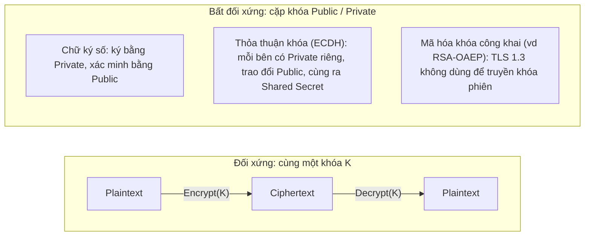

**Giải thích.** Bên trái là mô hình đối xứng: một khóa K chung cho cả hai chiều, tốc độ cao nhưng phải có K trước. Bên phải là ba ứng dụng khác nhau của bất đối xứng. TLS 1.3 chỉ dùng hai trong ba: chữ ký số (để xác thực) và thỏa thuận khóa (để tạo K cho phần đối xứng). Cái thứ ba (mã hóa khóa công khai) có trong lịch sử TLS 1.2 (RSA key exchange), nhưng TLS 1.3 đã loại bỏ.

### Tóm tắt Chương 1

- TLS nhằm đạt ba mục tiêu: bí mật, toàn vẹn, xác thực.
- Đối xứng nhanh, dùng bảo vệ dữ liệu, nhưng cần khóa chung.
- Bất đối xứng gồm ba ứng dụng khác nhau. TLS 1.3 dùng chữ ký số và thỏa thuận khóa.
- TLS ghép nhiều cơ chế, mỗi cơ chế một vai trò: ECDHE, Certificate/chữ ký, HMAC, HKDF, AES-GCM.

### Ba câu hỏi kiểm tra

1. Vì sao TLS không dùng bất đối xứng để mã hóa toàn bộ dữ liệu HTTP?
2. Chữ ký số khác "mã hóa bằng Private Key" ở điểm nào về mục đích và cách dùng?
3. Trong TLS 1.3, cơ chế nào chịu trách nhiệm cho từng mục tiêu: bí mật, toàn vẹn, xác thực?

### Nối sang chương sau

Khóa chung K cho phần đối xứng phải có từ đâu đó mà không được gửi qua mạng. Chương 2 trả lời bằng ECDHE.

---

## Chương 2. ECDHE và Shared Secret

### 2.1. Bài toán thiết lập khóa chung

Client và Server chưa từng liên lạc, không có bí mật nào chung từ trước. Kẻ nghe lén xem được **mọi thứ** đi qua mạng. Làm thế nào hai bên có thể tạo ra **cùng một bí mật** mà bí mật đó không bao giờ đi qua mạng?

### 2.2. Diffie-Hellman và ECDHE

**Ý tưởng Diffie-Hellman.** Mỗi bên chọn một số bí mật riêng (Private). Từ số bí mật, mỗi bên tính ra một giá trị công khai (Public) bằng một phép toán một chiều. Hai bên trao đổi Public. Rồi mỗi bên kết hợp Private của mình với Public của bên kia. Nhờ tính chất toán học, **cả hai ra cùng một kết quả**, trong khi kẻ nghe lén chỉ có hai Public nên không tính được.

**Ví dụ số nhỏ (Diffie-Hellman cổ điển, chỉ để thấy ý tưởng).**

> **[Minh họa]** Chọn số nguyên tố p = 23 và g = 5 (công khai). Client chọn Private a = 6, Server chọn Private b = 15.
> - Client tính Public A = 5^6 mod 23 = **8**, gửi cho Server.
> - Server tính Public B = 5^15 mod 23 = **19**, gửi cho Client.
> - Client tính Shared = B^a mod 23 = 19^6 mod 23 = **2**.
> - Server tính Shared = A^b mod 23 = 8^15 mod 23 = **2**.
>
> Hai bên cùng ra 2 mà chưa từng truyền số 2. Kẻ nghe lén thấy 8 và 19 nhưng với số đủ lớn thì không thể suy ra 2.

**ECDH (Elliptic Curve Diffie-Hellman)** là cùng ý tưởng nhưng thay phép toán "lũy thừa modulo" bằng phép nhân một điểm trên đường cong elliptic với một số nguyên. Cách này đạt cùng mức bảo mật với khóa ngắn hơn nhiều và nhanh hơn. Tài liệu này không đi vào toán của đường cong.

- Private: một số ngẫu nhiên k.
- Public: điểm k·G (G là điểm cơ sở công khai của đường cong).
- Shared Secret: Client tính c·(S) = c·(s·G), Server tính s·(C) = s·(c·G). Hai kết quả bằng nhau.

**"Ephemeral" (E trong ECDHE) nghĩa là gì.** Mỗi kết nối, mỗi bên **tạo mới** một cặp khóa ECDHE, dùng một lần để tính Shared Secret, rồi **xóa Private Key**. Khóa không tái sử dụng giữa các kết nối.

**Vì sao dùng khóa tạm thời.** Nếu Private Key bị xóa sau Handshake, thì dù sau này kẻ tấn công có chiếm được khóa dài hạn của server, họ cũng không thể tính lại Shared Secret của phiên cũ. Đây là nền tảng của **Forward Secrecy** ([Chương 9](#chương-9-mitm-và-forward-secrecy)).

> **[RFC]** TLS 1.3 bắt buộc cipher suite dùng thỏa thuận khóa dạng (EC)DHE khi không dùng PSK-only. Nhóm đường cong bắt buộc hỗ trợ là secp256r1 (NIST P-256), khuyến nghị hỗ trợ X25519 (RFC 8446 mục 9.1; X25519 định nghĩa trong RFC 7748).
> **[Triển khai]** Phần lớn trình duyệt và server hiện đại ưu tiên X25519. Public Key X25519 dài 32 byte, Shared Secret cũng 32 byte.

### 2.3. Trao đổi KeyShare

Việc trao đổi Public Key diễn ra ngay trong hai thông điệp đầu tiên của Handshake, ở dạng plaintext:

**Client:**
1. Tạo ECDHE Private Key tạm thời `c`.
2. Tính ECDHE Public Key `C = c·G`.
3. Gửi `C` trong extension `key_share` của **ClientHello** (kèm danh sách nhóm đường cong hỗ trợ `supported_groups`).

**Server:**
1. Chọn một nhóm đường cong Client đã gợi ý.
2. Tạo ECDHE Private Key tạm thời `s`, tính Public Key `S = s·G`.
3. Gửi `S` trong extension `key_share` của **ServerHello**.

**Cả hai tính Shared Secret:**

- Client: `Shared = ECDH(c, S)`
- Server: `Shared = ECDH(s, C)`
- Hai kết quả **bằng nhau**.

> **[Triển khai]** Client thường đoán trước một nhóm đường cong (thường X25519) và gửi luôn `key_share` cho nhóm đó để tiết kiệm một vòng. Nếu Server không chấp nhận nhóm đoán, Server gửi HelloRetryRequest để yêu cầu Client gửi lại với nhóm khác. Phần này nằm ngoài trọng tâm.

**Điều quan trọng.** Shared Secret **không bao giờ được truyền**. Chỉ hai Public Key đi qua mạng. Shared Secret cũng **không dùng trực tiếp làm khóa mã hóa**: nó là đầu vào cho quá trình dẫn xuất khóa HKDF ([Chương 6](#chương-6-hkdf-và-key-schedule)).

### Sơ đồ 2. ECDHE Key Agreement

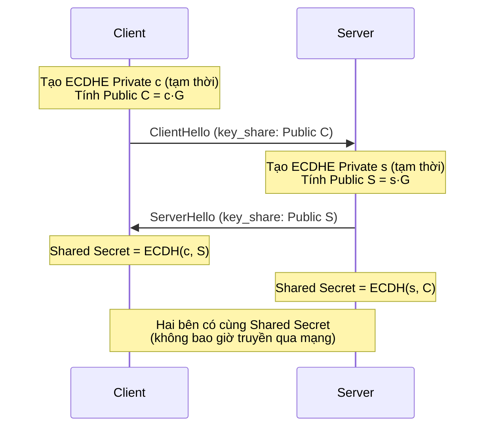

**Giải thích.** Chỉ `C` và `S` (Public Key) đi qua mạng. Mỗi bên giữ Private Key `c`, `s` trong bộ nhớ. Hai phép tính `ECDH(c, S)` và `ECDH(s, C)` cho cùng kết quả nhờ tính chất của đường cong.

### 2.4. Kẻ tấn công thấy gì

| Kẻ tấn công **thấy** | Kẻ tấn công **không thấy** |
|---|---|
| ECDHE Public Key của Client (`C`) | ECDHE Private Key của Client (`c`) |
| ECDHE Public Key của Server (`S`) | ECDHE Private Key của Server (`s`) |
| Toàn bộ ClientHello và ServerHello (plaintext) | Shared Secret |

Từ `C` và `S`, việc tính `Shared` đòi hỏi giải bài toán logarit rời rạc trên đường cong (đảo ngược phép nhân điểm), được coi là không khả thi với kích thước khóa đang dùng.

### 2.5. ECDHE có xác thực server không?

**Không.** Đây là điểm cực kỳ quan trọng.

ECDHE chỉ bảo đảm: nếu hai bên thực hiện đúng, họ có chung một bí mật mà người nghe lén không biết. Nó **không** cho biết người ở đầu bên kia là ai.

**Mô phỏng MITM** (kẻ tấn công không bị chặn bởi gì ngoài ECDHE):

- Kẻ tấn công M chặn đường giữa Client và Server.
- M thay Public Key của Client bằng Public Key của M gửi cho Server, và thay Public Key của Server bằng Public Key của M gửi cho Client.
- Client tạo Shared Secret **A** với M. Server tạo Shared Secret **B** với M.
- M giải mã dữ liệu của Client bằng A, đọc hoặc sửa, rồi mã hóa lại bằng B gửi cho Server, và ngược lại.
- Cả hai đầu đều thấy mã hóa hoạt động bình thường mà không biết M đang đứng giữa.

### Sơ đồ 3. MITM khi ECDHE không được xác thực

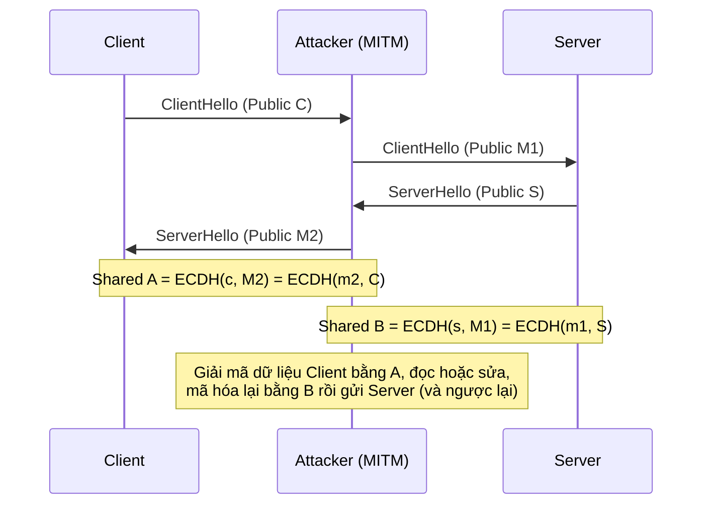

**Giải thích.** Hai kết nối mã hóa độc lập, một giữa Client và M, một giữa M và Server. Mã hóa mạnh không đồng nghĩa với nói chuyện đúng người. Để chặn kịch bản này, TLS cần thêm cơ chế **xác thực**: Certificate, CertificateVerify, Finished (các chương 3, 4, 5).

> **Hiểu lầm thường gặp.** "ECDHE đã mã hóa rồi nên an toàn trước MITM." Sai. ECDHE bảo vệ trước người **chỉ nghe lén**, không bảo vệ trước người **chủ động chen giữa**.

### Tóm tắt Chương 2

- ECDHE cho phép hai bên tạo cùng một Shared Secret mà không truyền nó, chỉ trao đổi Public Key.
- "Ephemeral": khóa tạm thời cho từng kết nối, Private Key bị xóa sau đó, nền tảng của Forward Secrecy.
- Shared Secret không phải khóa mã hóa mà là đầu vào của HKDF.
- ECDHE không xác thực server, nên đứng một mình thì bị MITM.

### Ba câu hỏi kiểm tra

1. Trong ECDHE, những gì đi qua mạng và những gì không bao giờ đi qua mạng?
2. Vì sao kẻ nghe lén (chỉ nhìn, không can thiệp) không tính được Shared Secret, nhưng kẻ chen giữa (MITM) lại tạo được hai Shared Secret riêng?
3. Chữ "Ephemeral" mang lại lợi ích bảo mật nào, và nó liên quan thế nào đến việc server bị lộ khóa dài hạn sau này?

### Nối sang chương sau

Để chặn MITM, Client cần biết Public Key mà mình đang nhận thuộc đúng server. Việc gắn danh tính với một Public Key là nhiệm vụ của Certificate (Chương 3).

---

## Chương 3. Certificate và xác thực server

### 3.1. Certificate là gì

**Bối cảnh.** Chương 2 cho thấy ECDHE không biết người đối diện là ai. Client cần một cách để biết "Public Key này thuộc đúng `example.com`". Cần một bên thứ ba đáng tin xác nhận điều đó.

**Định nghĩa.** Certificate (X.509) là một tệp dữ liệu có cấu trúc, **gắn một Public Key với một danh tính**, và được **ký bởi một Certification Authority (CA)**.

**Các trường quan trọng:**

| Trường | Ý nghĩa |
|---|---|
| **Subject Alternative Name (SAN)** | Danh sách tên miền (hoặc IP) mà chứng chỉ hợp lệ cho. Đây là trường Client dùng để so khớp hostname. Trường Common Name (CN) cũ không còn được dùng để xác minh hostname |
| **Public Key** (kèm thuật toán) | Public Key của server (**Certificate Public Key**), dùng để xác minh chữ ký CertificateVerify |
| **Issuer** | CA đã cấp (ký) chứng chỉ |
| **Validity** (`notBefore`, `notAfter`) | Khoảng thời gian hiệu lực |
| **Chữ ký của CA** | Chữ ký số của CA trên toàn bộ nội dung chứng chỉ, bảo đảm không bị sửa |
| **Key Usage / Extended Key Usage** | Mục đích được phép dùng khóa (ví dụ `digitalSignature`, `serverAuth`) |
| **Basic Constraints** | Chứng chỉ này có phải của một CA (được phép cấp chứng chỉ khác) hay không |
| Một số extension khác | Thông tin truy vấn thu hồi (CRL/OCSP), chứng nhận minh bạch (SCT)... |

**Điều Certificate bảo đảm và không bảo đảm:**

- Bảo đảm: một CA tin cậy đã xác nhận rằng chủ sở hữu Public Key này kiểm soát tên miền được ghi trong SAN (mức xác nhận tùy loại chứng chỉ).
- **Không** bảo đảm: kẻ nào đó trình ra Certificate này đang **giữ Private Key tương ứng**. Certificate là thông tin công khai, ai cũng có thể sao chép và gửi đi.

### 3.2. Chuỗi chứng chỉ (Certificate Chain)

Server thường không có chứng chỉ ký trực tiếp bởi Root CA, mà qua một hoặc nhiều **Intermediate CA**:

```
Server Certificate (leaf)
  → ký bởi Intermediate CA
    → ký bởi Root CA (nằm sẵn trong Trust Store của Client)
```

**Các khái niệm:**

- **Root CA:** CA gốc, tự ký, khóa riêng thường được giữ offline với biện pháp bảo vệ cao. Chứng chỉ gốc **được cài sẵn** trong Trust Store.
- **Intermediate CA:** CA trung gian do Root ký, thực hiện việc cấp chứng chỉ hằng ngày. Dùng Intermediate để Root key ít phải "ra ngoài" và có thể thu hồi một Intermediate mà không phải thay Root.
- **Trust Store:** tập các Root CA mà hệ điều hành, trình duyệt hoặc ứng dụng tin tưởng.
- **Vì sao Client tin một Root CA?** Không phải bằng suy luận mật mã mà bằng **quyết định tin cậy được cài sẵn**: nhà cung cấp OS/trình duyệt đưa vào Trust Store các CA tuân thủ chính sách và kiểm toán. Mật mã chỉ bảo đảm chuỗi chữ ký liền mạch từ leaf tới Root.
- **CA xác nhận điều gì?** CA xác nhận danh tính (ở mức tùy loại chứng chỉ, tối thiểu là quyền kiểm soát tên miền) và gắn nó với một Public Key bằng chữ ký của mình.

> **[RFC]** Trong TLS 1.3, Server gửi chuỗi chứng chỉ trong thông điệp Certificate. Chứng chỉ trust anchor (gốc) có thể được bỏ khỏi chuỗi nếu bên nhận chắc chắn đã có sẵn (RFC 8446 mục 4.4.2). **[Triển khai]** Server thường gửi leaf + intermediate, không gửi Root.

### Sơ đồ 4. Certificate Chain

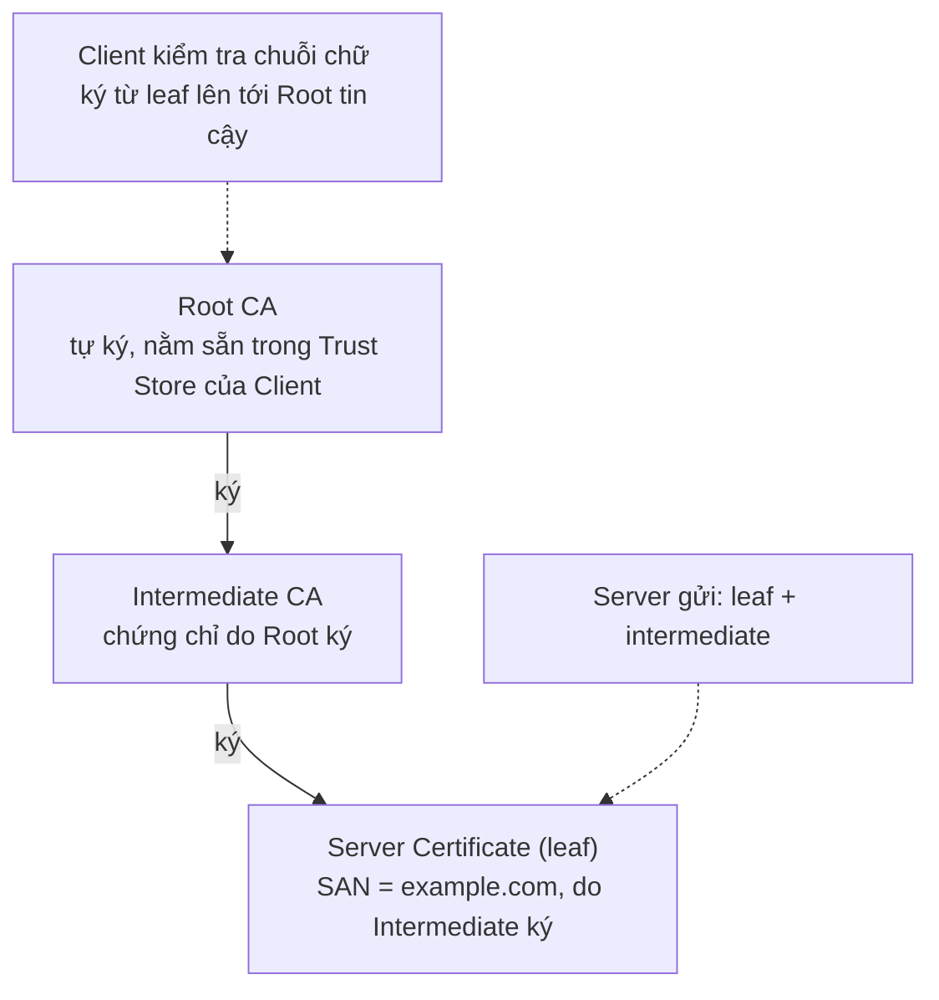

**Giải thích.** Mỗi mũi tên "ký" nghĩa là CA phía trên dùng Private Key của mình ký chứng chỉ phía dưới. Client lần ngược từ leaf lên đến một Root có trong Trust Store; nếu mọi chữ ký hợp lệ và đều trong hiệu lực thì chuỗi được tin.

### 3.3. Client kiểm tra Certificate như thế nào

| Kiểm tra | Nội dung | Nếu thiếu |
|---|---|---|
| **Hostname Verification** | Tên miền Client định kết nối có nằm trong SAN không (kể cả quy tắc wildcard) | Server có chứng chỉ hợp lệ của **tên miền khác** vẫn qua được |
| **Chain Validation** | Mọi chữ ký trong chuỗi hợp lệ, tới được một Trust Anchor | Chứng chỉ do ai cũng tự ký vẫn qua |
| **Validity Period** | Thời điểm hiện tại nằm trong `notBefore`–`notAfter` của mọi chứng chỉ | Chứng chỉ hết hạn hoặc chưa hiệu lực vẫn được chấp nhận |
| **Signature Verification** | Chữ ký của từng CA trên chứng chỉ bên dưới đúng | Chứng chỉ bị sửa đổi vẫn qua |
| **Key Usage / Extended Key Usage / Basic Constraints** | Chứng chỉ được phép dùng cho xác thực server, CA trung gian được phép làm CA | Chứng chỉ dùng sai mục đích vẫn qua |
| **Trust Anchor** | Điểm cuối chuỗi là Root nằm trong Trust Store | Chuỗi tự dựng vẫn qua |
| **Revocation** | Chứng chỉ có bị thu hồi chưa | Chứng chỉ đã bị lộ khóa vẫn dùng được |

**Thu hồi (Revocation) và giới hạn thực tế.**

- Cách truyền thống: **CRL** (danh sách thu hồi tải về) và **OCSP** (hỏi CA trạng thái từng chứng chỉ).
- Hạn chế thực tế: truy vấn làm tăng độ trễ, lộ thông tin trang đang truy cập cho CA (riêng tư), nhiều client **soft-fail** (nếu không hỏi được thì vẫn cho qua), nên hiệu quả không đảm bảo.
- **OCSP stapling:** Server tự đính kèm phản hồi OCSP đã ký sẵn trong chính Handshake, giảm độ trễ và vấn đề riêng tư. Trong TLS 1.3, thông tin OCSP của server nằm trong extension của `CertificateEntry` (RFC 8446 mục 4.4.2.1).
- **[Triển khai]** Trình duyệt thường bổ sung bằng danh sách thu hồi do trình duyệt tự phân phối, và xu hướng ngành là dùng chứng chỉ có hạn ngắn để giảm nhu cầu thu hồi.

> **Hiểu lầm thường gặp.** "Thấy ổ khóa nghĩa là website an toàn." Sai. Ổ khóa chỉ nói chuỗi chứng chỉ hợp lệ cho tên miền đó và kênh được mã hóa, không nói gì về việc trang đó có lừa đảo hay không.

### 3.4. Certificate có đủ chứng minh server giữ Private Key không

**Chưa đủ.**

Certificate cung cấp một Public Key **gắn với danh tính được chứng thực**. Nhưng Certificate là dữ liệu công khai: kẻ tấn công có thể ghi lại Certificate của server thật và gửi lại cho Client.

Để Client tin chắc đang nói chuyện với **chủ thực sự** của Certificate, server phải **chứng minh đang giữ Private Key** tương ứng với Public Key trong Certificate, và chứng minh theo cách **gắn với chính phiên này** để kẻ khác không phát lại được.

Việc này do **CertificateVerify** đảm nhiệm (Chương 4).

### Tóm tắt Chương 3

- Certificate gắn Public Key với danh tính, được CA ký.
- Chuỗi: leaf, Intermediate, Root (trong Trust Store). Client tin Root nhờ quyết định tin cậy được cài sẵn.
- Client kiểm tra hostname, chuỗi, thời hạn, chữ ký, mục đích sử dụng, thu hồi (với nhiều giới hạn thực tế).
- Certificate công khai nên không chứng minh người trình ra nó giữ Private Key.

### Ba câu hỏi kiểm tra

1. Nếu kẻ tấn công ghi lại và gửi lại đúng Certificate của server thật, điều gì còn thiếu để Client biết đây là kẻ giả?
2. Vì sao hostname verification là bước không thể bỏ, dù chuỗi chứng chỉ hoàn toàn hợp lệ?
3. Vì sao việc kiểm tra thu hồi (revocation) trong thực tế không đáng tin cậy tuyệt đối?

### Nối sang chương sau

Server cần chứng minh sở hữu Private Key bằng cách ký một dữ liệu gắn với phiên hiện tại. Dữ liệu đó là **Transcript Hash**, và chữ ký là **CertificateVerify** (Chương 4).

---

## Chương 4. Transcript Hash và CertificateVerify

### 4.1. Handshake Transcript là gì

**Bối cảnh.** Server cần ký một dữ liệu để chứng minh sở hữu Private Key. Nếu ký một giá trị cố định (hoặc giá trị Client có thể đoán trước), kẻ tấn công có thể phát lại chữ ký cũ. Cần dữ liệu **gắn chặt với chính phiên Handshake đang diễn ra**.

**Handshake Transcript** là chuỗi **các thông điệp Handshake** theo đúng thứ tự trao đổi giữa hai bên. **Transcript Hash** là giá trị Hash của chuỗi đó.

> **[RFC]** Transcript Hash là Hash (ở đây SHA-256) của phép nối các thông điệp Handshake, **tính cả phần header của thông điệp Handshake** (loại và độ dài) nhưng **không tính header của Record Layer** (RFC 8446 mục 4.4.1). Các thông điệp ChangeCipherSpec tương thích và Alert **không** nằm trong Transcript.

**Điểm hay hiểu sai.** Transcript Hash **không phải** Hash của toàn bộ byte trên đường truyền, và **không phải** Hash của dữ liệu ứng dụng. Nó chỉ tính nội dung các thông điệp Handshake (ở dạng plaintext, trước khi bị mã hóa thành Record).

**Mỗi thời điểm dùng một phạm vi Transcript khác nhau:**

| Dùng cho | Phạm vi Transcript (luồng chính, không có Client Certificate) |
|---|---|
| Handshake Traffic Secret (client và server) | ClientHello … ServerHello |
| CertificateVerify của Server | ClientHello … Certificate |
| Server Finished | ClientHello … CertificateVerify |
| Application Traffic Secret (client và server) | ClientHello … Server Finished |
| Client Finished | ClientHello … Server Finished |

**Tính chất cốt lõi.** Chỉ cần **một byte** trong bất kỳ thông điệp nào thay đổi, Transcript Hash đổi hoàn toàn. Nên Transcript Hash đóng vai trò "dấu vân tay của toàn bộ Handshake cho tới thời điểm đó".

> **[Triển khai]** Khi có HelloRetryRequest, Transcript có một quy tắc thay thế đặc biệt cho ClientHello đầu tiên. Phần này nằm ngoài trọng tâm.

### 4.2. CertificateVerify hoạt động như thế nào

**Mục tiêu.** Server chứng minh: (a) đang giữ Certificate Private Key tương ứng Public Key trong Certificate, và (b) chứng minh đó gắn với **đúng Handshake này** (kể cả hai ECDHE Public Key đã trao đổi).

**Server thực hiện:**

1. Tính Transcript Hash của ClientHello … Certificate.
2. Dựng dữ liệu cần ký theo đúng quy định TLS 1.3, gồm bốn phần nối nhau:
   - **64 byte** giá trị `0x20` (ký tự space) lặp lại.
   - **Context string:** `"TLS 1.3, server CertificateVerify"`.
   - **Một byte `0x00`** làm dấu phân cách.
   - **Transcript Hash** từ bước 1.
3. Dùng **Certificate Private Key** để ký dữ liệu đó, bằng thuật toán chữ ký đã thương lượng (ví dụ ECDSA P-256).
4. Gửi chữ ký trong thông điệp **CertificateVerify**.

**Client thực hiện:**

1. Xác minh Certificate (chuỗi, hostname, hạn... theo Chương 3).
2. Lấy **Certificate Public Key** từ Certificate đã xác minh.
3. **Tự tính** Transcript Hash của ClientHello … Certificate theo những gì **chính Client** đã gửi và nhận.
4. Dựng lại **cùng** dữ liệu cần ký (64 byte `0x20` + context string + `0x00` + hash).
5. Xác minh chữ ký bằng Public Key. Sai thì hủy Handshake.

**Vì sao có phần tiền tố 64 byte `0x20` và context string.** Để **tách biệt miền sử dụng (domain separation)**: chữ ký này chỉ có ý nghĩa là CertificateVerify của server trong TLS 1.3, không thể bị dùng lại như chữ ký ở giao thức hoặc ngữ cảnh khác (ví dụ chữ ký của client trong cùng giao thức dùng context string khác: `"TLS 1.3, client CertificateVerify"`).

> **[RFC]** Thuật toán chữ ký của CertificateVerify được thương lượng qua extension `signature_algorithms`, **độc lập** với tên cipher suite. Với RSA, TLS 1.3 **bắt buộc** dùng RSASSA-PSS trong CertificateVerify (chữ ký RSA PKCS#1 v1.5 chỉ còn được dùng để ký chính các chứng chỉ). (RFC 8446 mục 4.4.3, 9.1)

### Sơ đồ 5. CertificateVerify và Transcript Hash

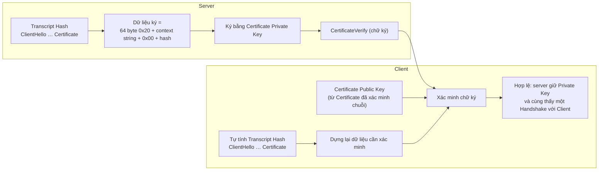

**Giải thích.** Hai bên tính độc lập cùng một Transcript Hash. Nếu hai bên **thấy cùng một Handshake** (cùng ClientHello, cùng ServerHello, cùng hai ECDHE Public Key) thì hash trùng, chữ ký xác minh thành công. Nếu **có ai đó thay đổi bất kỳ thông điệp nào**, hash phía Client khác hash phía Server và chữ ký thất bại.

### 4.3. Vì sao CertificateVerify ngăn MITM

**Giả sử kẻ tấn công M chen giữa** (như ở Sơ đồ 3) bằng cách thay ECDHE Public Key trong ClientHello gửi Server và trong ServerHello gửi Client.

**Hệ quả đầu tiên: Handshake Traffic Key ở hai đoạn khác nhau.**

- Đoạn Client↔M dùng Shared Secret và Transcript khác đoạn M↔Server, nên **Handshake Traffic Key khác nhau**.
- Các thông điệp EncryptedExtensions, Certificate, CertificateVerify của Server được mã hóa bằng Server Handshake Key của đoạn M↔Server. M (biết khóa đoạn này) giải mã được và **phải mã hóa lại** bằng khóa của đoạn Client↔M để Client đọc được.

**M thử các cách:**

| M làm gì | Kết quả |
|---|---|
| **Chuyển tiếp nguyên Certificate và CertificateVerify thật của Server** | Chuỗi chứng chỉ Client kiểm tra **hợp lệ** (đây là chứng chỉ thật). Nhưng chữ ký được Server tính trên Transcript của **đoạn M↔Server** (chứa ClientHello của M và ServerHello thật). Transcript phía **Client** chứa ClientHello thật và ServerHello do M tạo. **Hash khác nhau, chữ ký không xác minh được.** |
| **Tự ký CertificateVerify bằng khóa của M** nhưng dùng Certificate thật của Server | Client xác minh bằng **Public Key trong Certificate thật**. Chữ ký của M không khớp. **Thất bại.** |
| **Dùng Certificate của chính M** | Client kiểm tra chuỗi và hostname: không có CA tin cậy nào ký chứng chỉ cho tên miền đó cho M. **Thất bại** (trừ khi CA bị xâm phạm, xem [Chương 9](#chương-9-mitm-và-forward-secrecy)). |

**Kết luận.** M không có Certificate Private Key của server nên **không thể tạo chữ ký hợp lệ** trên Transcript mà Client tính. CertificateVerify liên kết ba thứ lại: **danh tính** (Certificate), **sở hữu khóa** (chữ ký) và **ECDHE Public Key hai bên đã thấy** (nằm trong Transcript).

> **Lưu ý về độ chính xác.** Mô tả tấn công phải tính đến việc Handshake đã bị mã hóa: M chỉ chuyển tiếp được các thông điệp này sau khi giải mã bằng khóa đoạn M↔Server và mã hóa lại bằng khóa đoạn Client↔M. Nhưng việc "chuyển tiếp được" không giúp M vượt qua CertificateVerify, vì nội dung thông điệp (và Transcript) mới là thứ quyết định chữ ký.

### 4.4. Phân biệt chữ ký của CA và chữ ký CertificateVerify

| | Chữ ký của CA trên Certificate | Chữ ký CertificateVerify |
|---|---|---|
| **Ai ký** | CA (Intermediate hoặc Root) | Server |
| **Khóa ký** | Private Key của CA | **Certificate Private Key** của server |
| **Ký cái gì** | Nội dung chứng chỉ (tên, Public Key, thời hạn...) | Dữ liệu gồm context string + **Transcript Hash của Handshake hiện tại** |
| **Ai xác minh, bằng khóa nào** | Client, bằng Public Key của CA (trong chuỗi) | Client, bằng **Certificate Public Key** của server |
| **Mục tiêu** | "CA xác nhận Public Key này thuộc danh tính này" | "Người đang kết nối giữ Private Key đó, và đang ở **đúng Handshake này**" |
| **Tính tái sử dụng** | Dùng lại cho mọi kết nối trong thời hạn chứng chỉ | **Chỉ dùng cho một Handshake** (vì Transcript chứa giá trị ngẫu nhiên và ECDHE Public Key riêng của phiên) |

### Tóm tắt Chương 4

- Transcript Hash là Hash của các thông điệp Handshake theo thứ tự, không phải của dữ liệu ứng dụng hay toàn bộ byte đường truyền. Phạm vi thay đổi theo từng thời điểm.
- CertificateVerify là **chữ ký số** của server trên (64 byte `0x20` + context string + `0x00` + Transcript Hash), ký bằng Certificate Private Key.
- Client tự tính lại Transcript Hash và xác minh bằng Certificate Public Key.
- Nhờ ràng buộc với Transcript (chứa ECDHE Public Key hai bên), M thay khóa là chữ ký sai, và M không thể tự ký thay server.

### Ba câu hỏi kiểm tra

1. Vì sao dữ liệu ký của CertificateVerify chứa Transcript Hash thay vì một giá trị cố định?
2. Trong kịch bản MITM, vì sao việc M chuyển tiếp nguyên Certificate và CertificateVerify thật của Server vẫn không giúp M qua được kiểm tra của Client?
3. Phân biệt hai loại chữ ký trong Handshake: khóa nào ký, khóa nào xác minh, mục tiêu của từng loại?

### Nối sang chương sau

CertificateVerify chứng minh **danh tính** server tại thời điểm đó. Nhưng còn hai việc chưa được đảm bảo: hai bên có thật sự **cùng tính ra các khóa** hay không, và **toàn bộ Handshake** (kể cả phần sau CertificateVerify) có bị sửa đổi không. Đó là việc của **Finished** (Chương 5).

---

## Chương 5. Finished và toàn vẹn Handshake

### 5.1. Finished giải quyết vấn đề gì

Sau CertificateVerify, Client đã biết server có Certificate Private Key. Vì sao vẫn cần Finished? Cần phân biệt **ba việc khác nhau**:

| Việc cần bảo đảm | Ai đảm bảo | Còn thiếu gì nếu chỉ có cái này |
|---|---|---|
| **Xác thực danh tính server** (server là chủ Certificate) | CertificateVerify (chữ ký số) | Chưa chứng minh hai bên cùng tính ra **cùng khóa phiên** |
| **Xác nhận quyền sở hữu Handshake Secret** (bên gửi đã tính ra đúng các khóa của phiên này) | Finished (HMAC bằng khóa dẫn xuất từ Handshake Traffic Secret) | Finished một mình không xác thực **danh tính**, vì bất kỳ ai làm ECDHE đúng (kể cả M) cũng tính được Finished cho đoạn của mình |
| **Toàn vẹn toàn bộ Handshake** (không thông điệp nào, kể cả extension, bị đổi giữa đường, ví dụ ép hạ cấp thuật toán) | Finished (HMAC trên Transcript Hash) | CertificateVerify chỉ phủ Transcript tới Certificate, không phủ phần còn lại |

**Kết luận.** CertificateVerify **xác thực danh tính**, Finished **xác nhận khóa và toàn vẹn Handshake**. Hai cơ chế bổ sung cho nhau.

### 5.2. Finished Key

Mỗi bên có **Finished Key riêng** dẫn xuất từ **Handshake Traffic Secret của chính chiều gửi**:

```
Handshake Traffic Secret của bên gửi
   → HKDF-Expand-Label(secret, "finished", "", Hash.length)
   → Finished Key (32 byte với SHA-256)
```

> **[RFC]** `finished_key = HKDF-Expand-Label(BaseKey, "finished", "", Hash.length)`, với BaseKey là `server_handshake_traffic_secret` cho Server Finished và `client_handshake_traffic_secret` cho Client Finished (RFC 8446 mục 4.4.4).

Vì mọi Handshake Traffic Secret đều bắt nguồn từ ECDHE Shared Secret (Chương 6), **chỉ bên nào tính ra đúng Shared Secret mới tính được Finished Key đúng**.

### 5.3. Finished Verify Data

```
verify_data = HMAC(finished_key, Transcript-Hash(...))
```

**Phạm vi Transcript:**

| Thông điệp | Transcript được HMAC |
|---|---|
| **Server Finished** | ClientHello … CertificateVerify |
| **Client Finished** | ClientHello … Server Finished |

**Những điểm phải nhớ:**

- Finished **không dùng** Certificate Private Key. Nó là cơ chế **đối xứng** (HMAC).
- **Server Finished** và **Client Finished** dùng **hai Finished Key khác nhau**, mỗi cái ứng với một chiều.
- Transcript được xác thực ở hai thời điểm **không giống nhau**: Client Finished phủ cả Server Finished, nên bao hàm toàn bộ Handshake.
- **HMAC khác Hash:** Hash ai cũng tính được, nên không chứng minh gì. HMAC cần khóa, chỉ người biết khóa tính được kết quả đúng.
- **HMAC khác chữ ký số:** HMAC dùng khóa chung, hai bên đều tạo được, nên không chứng minh được "ai trong hai bên" đã tạo. Với mục đích Finished (hai bên đã cùng khóa) điều đó là đủ.

> **[RFC]** `verify_data = HMAC(finished_key, Transcript-Hash(Handshake Context, Certificate*, CertificateVerify*))` (RFC 8446 mục 4.4.4). Dấu `*` nghĩa là chỉ có khi thông điệp đó thực sự được gửi.

### Sơ đồ 6. Finished và HMAC

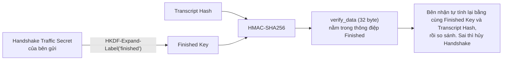

**Giải thích.** Bên gửi tính `verify_data` và gửi kèm. Bên nhận có cùng Handshake Traffic Secret (vì cùng ECDHE) và cùng Transcript, nên tự tính lại và so sánh. Khớp nghĩa là: cùng khóa, cùng thấy một Handshake.

### 5.4. Trình tự xác nhận

1. Server gửi **Server Finished** (sau Certificate, CertificateVerify).
2. Client:
   - Xác minh **Certificate** (chuỗi, hostname...).
   - Xác minh **CertificateVerify**.
   - Xác minh **Server Finished**.
3. Client gửi **Client Finished**.
4. Server xác minh **Client Finished**.

**Thứ tự này quan trọng.** Client chỉ gửi Client Finished sau khi đã tin server. Nếu bất kỳ bước xác minh nào thất bại, bên đó **hủy Handshake** (gửi alert và đóng kết nối), không gửi tiếp dữ liệu.

### 5.5. Phân biệt CertificateVerify và Finished

| Tiêu chí | CertificateVerify | Finished |
|---|---|---|
| **Mục đích** | Chứng minh server **giữ Certificate Private Key** (xác thực danh tính) | Xác nhận hai bên **cùng khóa** và **toàn bộ Handshake không bị sửa** |
| **Input** | Context string + Transcript Hash (ClientHello … Certificate) | Transcript Hash (ClientHello … CertificateVerify đối với Server Finished) |
| **Khóa sử dụng** | **Certificate Private Key** (bất đối xứng) để ký, Certificate Public Key để xác minh | **Finished Key** (đối xứng) dẫn xuất từ Handshake Traffic Secret |
| **Thuật toán** | Chữ ký số (ví dụ ECDSA, RSA-PSS) | HMAC (HMAC-SHA256) |
| **Bên tạo** | Server | Cả Server (Server Finished) và Client (Client Finished) |
| **Bên xác minh** | Client | Bên còn lại |
| **Rủi ro nếu thiếu** | Kẻ tấn công trình Certificate thật của server mà không có khóa, vẫn đóng vai server | Sửa đổi phần Handshake sau điểm ký (hoặc downgrade) không bị phát hiện, và không có xác nhận hai bên cùng khóa |

### Tóm tắt Chương 5

- CertificateVerify xác thực **danh tính** server. Finished xác nhận **khóa chung** và **toàn vẹn Handshake**.
- Finished Key dẫn xuất từ Handshake Traffic Secret của chiều gửi, bằng HKDF-Expand-Label với nhãn `"finished"`.
- `verify_data` là HMAC của Transcript Hash bằng Finished Key. Không dùng Certificate Private Key.
- Server Finished và Client Finished dùng khóa riêng cho mỗi chiều, phủ Transcript khác nhau.
- Trình tự: Client xác minh Certificate, CertificateVerify, Server Finished rồi mới gửi Client Finished. Server xác minh Client Finished.

### Ba câu hỏi kiểm tra

1. Nếu kẻ tấn công M tự dẫn xuất khóa cho đoạn Client↔M, M tạo được Finished hợp lệ cho Client không? Vì sao điều đó chưa đủ để M thành công?
2. Vì sao Finished là cơ chế đối xứng (HMAC) mà không cần chữ ký số?
3. Server Finished và Client Finished khác nhau ở khóa dùng và phạm vi Transcript thế nào?

### Nối sang chương sau

Chương này liên tục nhắc tới "Handshake Traffic Secret" và "Finished Key". Chúng đến từ đâu? Từ ECDHE Shared Secret qua một chuỗi dẫn xuất khóa HKDF theo lịch trình của TLS 1.3 (Chương 6).

---

## Chương 6. HKDF và Key Schedule

### 6.1. Tại sao Shared Secret chưa phải Traffic Key

Sau ECDHE, hai bên có Shared Secret (32 byte). Có thể muốn dùng thẳng làm khóa AES. TLS không làm vậy, vì:

1. **TLS cần nhiều khóa, không phải một.** Handshake cần khóa cho việc mã hóa thông điệp Handshake, khóa cho Finished, rồi khóa cho dữ liệu ứng dụng.
2. **Các khóa phải có mục đích tách biệt.** Lộ khóa của mục đích này không được kéo theo lộ khóa của mục đích khác.
3. **Handshake Key và Application Key phải khác nhau.** Hai giai đoạn có mức xác thực khác nhau (khi Handshake đang diễn ra, danh tính chưa được xác nhận xong).
4. **Mỗi chiều cần khóa riêng** (Client → Server và Server → Client). Nếu dùng chung một khóa cho hai chiều, hai bên đều đếm Sequence Number từ 0 nên có thể sinh ra **cùng cặp (Key, Nonce)**, đây là lỗi nghiêm trọng với AES-GCM (xem Chương 7).
5. **Shared Secret thô chưa phải là chuỗi bit "đồng đều" lý tưởng**, và cần được **buộc chặt vào Handshake** (Transcript) để khóa chỉ đúng với phiên này.

Cần một cơ chế **dẫn xuất khóa (Key Derivation Function, KDF)**: từ một nguyên liệu bí mật tạo ra nhiều khóa độc lập, theo nhãn và theo ngữ cảnh. TLS 1.3 dùng **HKDF**.

### 6.2. HKDF là gì

**HKDF** (HMAC-based Key Derivation Function, RFC 5869) là KDF **dựa trên HMAC**, mà HMAC lại dựa trên một **hàm Hash** (ở đây SHA-256).

Hai thao tác cơ bản:

| Thao tác | Input | Output | Vai trò |
|---|---|---|---|
| **HKDF-Extract(salt, IKM)** | `salt` (muối), `IKM` (nguyên liệu khóa đầu vào) | Một khóa gốc "đồng đều" (PRK, 32 byte) | **Gom** độ ngẫu nhiên của IKM thành một khóa gốc chất lượng tốt, trộn với salt |
| **HKDF-Expand(PRK, info, L)** | khóa gốc, `info` (nhãn/ngữ cảnh), độ dài `L` | `L` byte khóa dẫn xuất | **Kéo dài** khóa gốc thành các khóa con. Mỗi `info` khác nhau cho ra khóa con **độc lập** |

**HKDF-Expand-Label (đặc thù TLS 1.3).** TLS gói `info` theo một cấu trúc cố định gồm độ dài, **nhãn có tiền tố `"tls13 "`**, và ngữ cảnh:

```
HKDF-Expand-Label(Secret, Label, Context, Length)
  = HKDF-Expand(Secret, HkdfLabel, Length)

HkdfLabel = {
  uint16  length  = Length
  opaque  label   = "tls13 " + Label
  opaque  context = Context
}
```

Tiền tố `"tls13 "` giúp tách biệt miền sử dụng với giao thức khác. Nhãn khác nhau (ví dụ `"key"`, `"iv"`, `"finished"`) cho ra output khác nhau dù cùng Secret.

**Derive-Secret** là cách TLS buộc khóa vào Handshake:

```
Derive-Secret(Secret, Label, Messages)
  = HKDF-Expand-Label(Secret, Label, Transcript-Hash(Messages), Hash.length)
```

Nghĩa là **Context chính là Transcript Hash** của các thông điệp Handshake tương ứng. Nhờ đó mỗi Secret dẫn xuất ra **gắn với đúng Handshake**: đổi bất kỳ thông điệp nào thì Secret thay đổi.

### 6.3. TLS 1.3 Key Schedule

Key Schedule gồm **ba giai đoạn nối tiếp**, mỗi giai đoạn là một lần `HKDF-Extract`, giữa hai giai đoạn có bước `Derive-Secret(..., "derived", "")` để nối chuỗi.

| Giai đoạn | Công thức | Ghi chú |
|---|---|---|
| **Early Secret** | `HKDF-Extract(salt = 0, IKM = PSK)` | Không dùng PSK thì `IKM` = chuỗi 32 byte 0. Luồng chính của tài liệu rơi vào trường hợp này |
| *(nối chuỗi)* | `derived = Derive-Secret(Early Secret, "derived", "")` | Transcript rỗng, tức Hash của chuỗi rỗng |
| **Handshake Secret** | `HKDF-Extract(salt = derived, IKM = ECDHE Shared Secret)` | **Nơi ECDHE Shared Secret được trộn vào** |
| Handshake Traffic Secret | `Derive-Secret(Handshake Secret, "c hs traffic", ClientHello…ServerHello)` và `"s hs traffic"` | Hai Secret, một cho mỗi chiều |
| *(nối chuỗi)* | `derived = Derive-Secret(Handshake Secret, "derived", "")` | |
| **Master Secret** | `HKDF-Extract(salt = derived, IKM = 0)` | IKM là 32 byte 0 |
| Application Traffic Secret | `Derive-Secret(Master Secret, "c ap traffic", ClientHello…server Finished)` và `"s ap traffic"` | Hai Secret, một cho mỗi chiều |

> **[RFC]** Đúng với RFC 8446 mục 7.1. Khi một Secret không có, dùng chuỗi `Hash.length` byte 0.

**Điều cần tránh khi mô tả.** Shared Secret **không** được đưa trực tiếp vào một lần `HKDF-Expand` duy nhất để sinh toàn bộ khóa. Thực tế là một **chuỗi Extract → Derive-Secret → Extract → ...**, với Transcript Hash tham gia ở những điểm xác định.

### Sơ đồ 7. TLS 1.3 Key Schedule

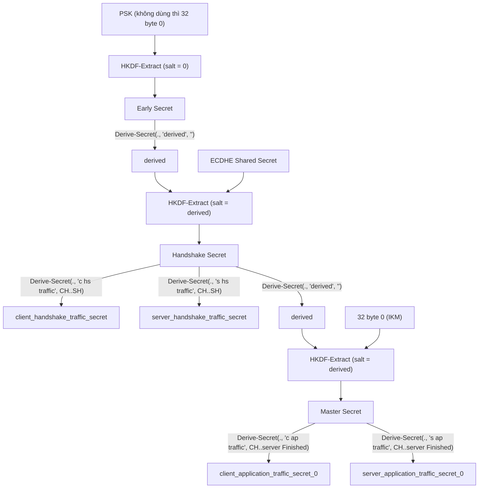

**Giải thích.** Đọc từ trên xuống. ECDHE Shared Secret chỉ vào ở giai đoạn Handshake Secret. Từ Handshake Secret, hai Handshake Traffic Secret được dẫn xuất ngay sau ServerHello (transcript `CH..SH` = ClientHello … ServerHello). Master Secret được tạo mà **không có thêm nguyên liệu mới** (IKM là 0), nhưng vẫn phụ thuộc Handshake Secret qua `derived`. Từ Master Secret, hai Application Traffic Secret được dẫn xuất sau khi Server Finished đã có (transcript `CH..server Finished`).

### 6.4. Handshake Traffic Secrets

- **client_handshake_traffic_secret** và **server_handshake_traffic_secret**.
- **Cả Client và Server đều tính được cả hai Secret**, vì cùng có Handshake Secret và cùng Transcript `ClientHello … ServerHello`.
- Mỗi bên dùng Secret của **chiều gửi** để mã hóa, và Secret của **chiều nhận** để giải mã:

| Bên | Gửi (mã hóa) bằng | Nhận (giải mã) bằng |
|---|---|---|
| **Server** | Server Handshake Key/IV (EncryptedExtensions, Certificate, CertificateVerify, Finished) | Client Handshake Key/IV (Client Finished) |
| **Client** | Client Handshake Key/IV (Client Finished) | Server Handshake Key/IV |

Từ cùng các Secret này còn dẫn xuất **Finished Key** cho từng chiều (Chương 5).

### 6.5. Application Traffic Secrets

- **client_application_traffic_secret_0** và **server_application_traffic_secret_0** (chỉ số 0 vì sau này KeyUpdate sẽ sinh N+1, N+2...).
- Dẫn xuất từ Master Secret với Transcript **ClientHello … Server Finished**, nên chỉ tính được **sau khi Server Finished đã có**.

**Thời điểm được phép sử dụng** (theo TLS 1.3):

| Bên | Dẫn xuất Application Secret khi nào | Được phép gửi Application Data khi nào |
|---|---|---|
| **Server** | Ngay khi đã gửi Server Finished (đã biết Transcript tới Server Finished) | **Ngay sau khi gửi Server Finished**, không cần đợi Client Finished. Lúc này dữ liệu gửi tới một peer **chưa được xác thực** (Client chưa gửi Finished) |
| **Client** | Sau khi nhận và xác minh Server Finished | **Sau khi gửi Client Finished** (Client Finished đi bằng Client Handshake Key, sau đó dữ liệu ứng dụng đi bằng Client Application Key) |

> **[RFC]** Application Data **không được gửi trước khi gửi Finished của chính mình** (trừ trường hợp 0-RTT, ngoài phạm vi). Server có thể gửi Application Data sau first flight, **trước khi nhận xác thực của Client**, với cảnh báo rằng dữ liệu đó gửi tới peer chưa được xác thực (RFC 8446 mục 2 và 4.4.4).

### 6.6. Traffic Secret, Traffic Key và Static IV

Application (và Handshake) Traffic Secret **không** trực tiếp là khóa AES. Từ **mỗi Traffic Secret**, hai giá trị được dẫn xuất bằng hai nhãn khác nhau:

```
Traffic Key = HKDF-Expand-Label(Traffic Secret, "key", "", key_length)
Static IV   = HKDF-Expand-Label(Traffic Secret, "iv",  "", iv_length)
```

**Kích thước với `TLS_AES_128_GCM_SHA256`:**

| Giá trị | Độ dài | Ghi chú |
|---|---|---|
| Hash length (SHA-256) | 32 byte | |
| **Traffic Secret** | 32 byte | = Hash length |
| **Traffic Key** (AES-128) | **16 byte** | `key_length` của AES-128 |
| **Static IV** (AES-GCM) | **12 byte** | `iv_length` của GCM |

**Vì sao hai output khác nhau.** Hai lần gọi `HKDF-Expand-Label` có **nhãn khác nhau** (`"key"` và `"iv"`) và **độ dài khác nhau**, nên `HkdfLabel` khác nhau, và HKDF-Expand cho hai đầu ra **độc lập** nhau về mặt tính toán. Biết Static IV không giúp suy ra Traffic Key.

### Sơ đồ 8. Traffic Secret → Traffic Key + Static IV

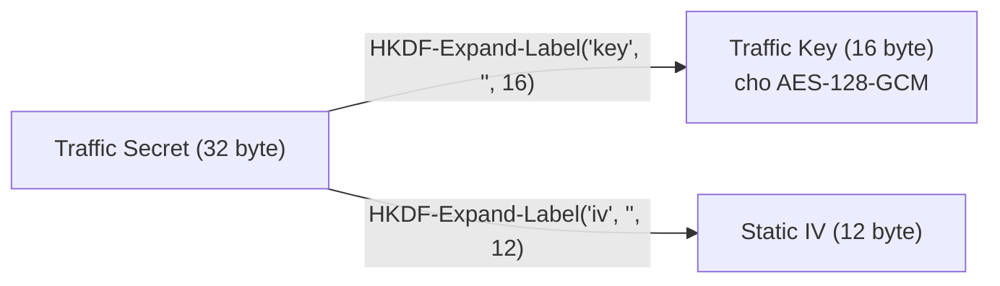

**Giải thích.** Mỗi Traffic Secret sinh đúng một cặp (Key, IV) cho **một chiều trong một giai đoạn**. Bốn Traffic Secret của Full Handshake (client/server × handshake/application) tương ứng bốn cặp (Key, IV).

> **Hiểu lầm thường gặp.** "Traffic Secret chính là khóa mã hóa." Sai. Secret là **gốc dẫn xuất**. Khóa AES (Traffic Key) và IV là hai giá trị dẫn xuất riêng từ nó.

### Tóm tắt Chương 6

- Cần nhiều khóa tách biệt (theo mục đích, giai đoạn, chiều), nên dùng KDF thay vì dùng thẳng Shared Secret.
- HKDF = Extract (gom) + Expand (kéo dài theo nhãn). TLS dùng Expand-Label và Derive-Secret (Context là Transcript Hash) để buộc khóa vào Handshake.
- Key Schedule: Early Secret → Handshake Secret (trộn ECDHE) → Master Secret, với các bước `derived` nối chuỗi.
- Mỗi giai đoạn sinh hai Traffic Secret (client, server). Cả hai bên tính được cả hai, mỗi bên dùng đúng chiều.
- Mỗi Traffic Secret → Traffic Key (16 byte) + Static IV (12 byte) bằng hai nhãn `"key"`, `"iv"`.

### Ba câu hỏi kiểm tra

1. Vì sao dùng thẳng ECDHE Shared Secret làm khóa AES là không đủ, kể cả khi nó "đủ dài"?
2. Trong Derive-Secret, vai trò của Transcript Hash là gì? Điều gì xảy ra với các Secret nếu ai đó sửa ServerHello?
3. Từ cùng một Traffic Secret, vì sao khóa AES (16 byte) và Static IV (12 byte) khác nhau và độc lập?

### Nối sang chương sau

Có Traffic Key và Static IV rồi. Chương 7 xem chúng được dùng thế nào để bảo vệ từng **TLS Record**, và Nonce của mỗi Record được tính ra sao.

---

## Chương 7. TLS Record, Static IV và Nonce

### 7.1. TLS Record là gì

**TLS Record Layer** là tầng cắt luồng dữ liệu (Handshake, Application Data) thành các **Record** để bảo vệ và truyền. Mỗi Record chứa tối đa **2^14 = 16384 byte** nội dung.

**Cấu trúc Record sau khi được mã hóa (TLSCiphertext):**

| Trường | Kích thước | Giá trị / ý nghĩa |
|---|---|---|
| `opaque_type` | 1 byte | **Luôn là 23** (`application_data`) với mọi Record được mã hóa, dù nội dung thật là gì |
| `legacy_record_version` | 2 byte | **Luôn là `0x0303`** (giá trị cũ giữ để tương thích) |
| `length` | 2 byte | Độ dài của `encrypted_record` ngay phía sau |
| `encrypted_record` | thay đổi | **Ciphertext** + **Authentication Tag** (16 byte) |

Ba trường đầu tạo thành **Record Header 5 byte**, **không mã hóa**.

**Bên trong phần được mã hóa (TLSInnerPlaintext):**

```
content          (dữ liệu thật: HTTP data, hoặc thông điệp Handshake)
ContentType      (1 byte: loại thật của nội dung, ví dụ handshake hoặc application_data)
zeros            (padding 0x00, tùy chọn)
```

**Hệ quả quan trọng.** TLS 1.3 **giấu loại nội dung thật** vào trong phần mã hóa. Từ bên ngoài, mọi Record mã hóa đều trông như `application_data`, kể cả Record chứa Certificate hay Finished. Đồng thời, **toàn bộ Handshake sau ServerHello được mã hóa** (khác TLS 1.2, nơi Certificate đi dạng plaintext).

> **[Triển khai]** Để tương thích với thiết bị mạng trung gian, TLS 1.3 thường gửi thêm một Record ChangeCipherSpec "giả" sau ClientHello/ServerHello. Nó không có ý nghĩa mật mã trong TLS 1.3 và không nằm trong Transcript.

> **Điều cần phân biệt:** HTTP Request thực tế, TLSInnerPlaintext và TLS Record là **ba thứ khác nhau**. Một HTTP Request **không** luôn tương ứng đúng một Record: dữ liệu có thể bị chia ra nhiều Record (nếu lớn hơn 16 KB), hoặc nhiều lần ghi của ứng dụng có thể được gộp.

### Sơ đồ 9. Cấu trúc TLS Record

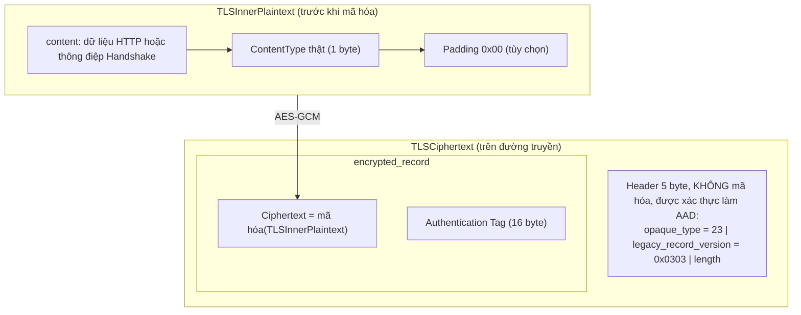

**Giải thích.** Bên trái dưới là dữ liệu thật trước khi bảo vệ. Qua AES-GCM nó biến thành Ciphertext, ghép với Tag thành `encrypted_record`, rồi đặt sau Header 5 byte. Header để rõ nhưng được đưa vào tính Tag (xem Chương 8), nên sửa Header thì Tag sai.

### 7.2. Tại sao TLS không tạo Traffic Key mới cho từng Record

1. **Chi phí tính toán:** dẫn xuất khóa cho từng Record là không cần thiết và tốn kém.
2. **Đã có cơ chế Nonce:** AES-GCM chỉ cần mỗi (Key, Nonce) dùng **một lần**. TLS bảo đảm điều đó bằng cách tạo Nonce **khác nhau** cho mỗi Record, trong khi giữ nguyên Key.
3. **Có giới hạn lượng dữ liệu dùng chung một Key.** Với AES-GCM, một Key chỉ nên mã hóa tối đa khoảng **2^24.5 Record kích thước tối đa (khoảng 24 triệu)** để giữ biên an toàn (RFC 8446 mục 5.5).
4. **KeyUpdate** (Chương 10) là cách đổi Key cho kết nối dài, mà không phải Handshake lại.

### 7.3. Static IV

- **Static IV** được dẫn xuất từ Traffic Secret (Chương 6): 12 byte với AES-GCM.
- Nó **không phải Nonce cuối cùng**. Nó chỉ là "gốc" để từ đó tính Nonce cho từng Record.
- Nó được **giữ nguyên trong suốt một key epoch** (khoảng thời gian dùng cùng một Traffic Secret) và chỉ đổi khi KeyUpdate.
- Mỗi chiều có Static IV riêng (`client_write_iv`, `server_write_iv`).

### 7.4. Sequence Number

- Mỗi **chiều truyền** có **Sequence Number riêng** (64 bit): một cho gửi, một cho nhận, ở mỗi bên.
- **Bắt đầu từ 0** khi kết nối bắt đầu **và mỗi khi Key đổi** (ví dụ khi chuyển từ Handshake Key sang Application Key, hoặc khi KeyUpdate).
- **Tăng 1 sau mỗi Record.**
- **Không được gửi tường minh** trong Record. Hai bên **tự đếm**: người nhận biết đây là Record thứ mấy theo thứ tự nhận (TCP bảo đảm thứ tự).
- Sequence Number **không được phép quay vòng** (wrap): trước khi hết, kết nối phải đổi Key hoặc đóng.

> **[RFC]** RFC 8446 mục 5.3: *"A 64-bit sequence number is maintained separately for reading and writing records."* và *"Each sequence number is set to zero at the beginning of a connection and whenever the key is changed."*

### 7.5. Tính Nonce

```
Nonce = Static IV  XOR  padded(Sequence Number)
```

**Cách làm (đúng RFC 8446 mục 5.3):**

1. Sequence Number 64 bit được mã hóa theo thứ tự byte mạng (big-endian) và **đệm số 0 vào bên trái** cho đủ độ dài IV (12 byte).
2. Giá trị đã đệm được **XOR** với Static IV (`client_write_iv` hoặc `server_write_iv`, tùy vai trò).

**Ví dụ với Static IV = `6d 3f a1 04 9c 52 e7 18 b3 2a 90 4e`:**

> **[Minh họa]** Chỉ có hai byte cuối của Sequence Number khác 0 trong các ví dụ này.

| Sequence Number | Sequence đã đệm (12 byte) | Nonce = IV XOR Sequence |
|---|---|---|
| 0 | `00 00 00 00 00 00 00 00 00 00 00 00` | `6d 3f a1 04 9c 52 e7 18 b3 2a 90 4e` (bằng IV) |
| 1 | `00 … 00 01` | `6d 3f a1 04 9c 52 e7 18 b3 2a 90 4f` |
| 2 | `00 … 00 02` | `6d 3f a1 04 9c 52 e7 18 b3 2a 90 4c` |
| 256 | `00 … 01 00` | `6d 3f a1 04 9c 52 e7 18 b3 2a 91 4e` |

**Giải thích:**

- **XOR không phải phép cộng số học.** Nó là phép toán từng bit. Ví dụ `0x4e XOR 0x01 = 0x4f`, `0x4e XOR 0x02 = 0x4c`.
- **Hai bên tạo cùng Nonce** vì cùng có Static IV (cùng dẫn xuất từ Traffic Secret) và cùng đếm Sequence Number cho cùng một chiều.
- **Nonce khác nhau giữa các Record** vì Sequence Number tăng. Với IV cố định, XOR với các số khác nhau cho các kết quả khác nhau (phép XOR với hằng số là song ánh).
- **Nonce không bí mật.** Người ngoài có thể suy ra Sequence Number, và biết (hoặc đoán) cách tạo Nonce không làm yếu bảo mật, miễn là Key bí mật.

### Sơ đồ 10. Static IV + Sequence Number → Nonce

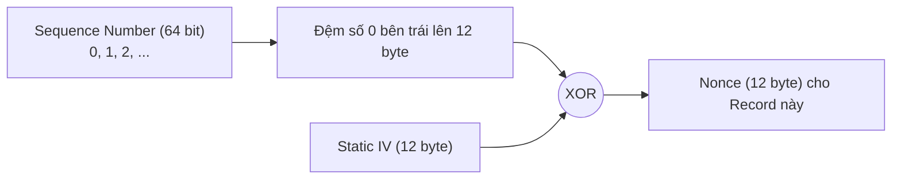

**Giải thích.** Mỗi Record dùng một Sequence Number mới nên có Nonce mới, trong khi Static IV và Traffic Key không đổi.

### 7.6. Tại sao không được tái sử dụng Key + Nonce

Với AES-GCM, nếu **cùng một Key** được dùng với **cùng một Nonce** cho hai Plaintext khác nhau thì:

1. **Rò rỉ thông tin:** hai Ciphertext dùng cùng "dòng khóa" (keystream), nên XOR hai Ciphertext cho ra XOR hai Plaintext. Từ đó kẻ tấn công có thể suy ra nội dung, đặc biệt khi đoán được một phần.
2. **Phá vỡ tính toàn vẹn:** tái sử dụng Nonce có thể làm lộ giá trị bí mật dùng để tính Authentication Tag, cho phép kẻ tấn công **giả mạo Tag hợp lệ** cho dữ liệu tùy ý.

**Nonce không cần bí mật nhưng phải duy nhất trong phạm vi cùng một Key.** Đây cũng là lý do mỗi chiều có Key riêng (Chương 6): hai chiều đều đếm từ 0, nếu chung Key thì Nonce của chiều Client→Server và Server→Client sẽ **trùng**.

### Tóm tắt Chương 7

- Record Layer cắt dữ liệu thành Record (tối đa 16 KB). Header 5 byte để rõ, phần còn lại là Ciphertext + Tag, loại nội dung thật được giấu vào trong.
- TLS giữ nguyên Traffic Key trong một epoch, và thay đổi **Nonce theo từng Record** thay vì đổi Key.
- Static IV cố định trong epoch. Sequence Number riêng từng chiều, bắt đầu 0, tăng mỗi Record, reset khi đổi Key, không gửi tường minh.
- `Nonce = Static IV XOR padded(Sequence Number)`.
- Tái sử dụng (Key, Nonce) phá cả bí mật lẫn toàn vẹn của AES-GCM.

### Ba câu hỏi kiểm tra

1. Static IV và Nonce khác nhau thế nào, và vì sao hai bên tính ra cùng Nonce mà không cần trao đổi nó?
2. Vì sao Sequence Number không cần gửi tường minh, và điều gì xảy ra với nó khi Key đổi?
3. Điều gì sẽ xảy ra nếu hai chiều truyền dùng chung một Traffic Key?

### Nối sang chương sau

Chương 7 cho biết Nonce và Key. Chương 8 xem AES-GCM dùng Key, Nonce, Plaintext và AAD để tạo ra Ciphertext và Tag như thế nào.

---

## Chương 8. AES-GCM, AEAD, AAD và Authentication Tag

### 8.1. AES-GCM là gì

- **AES** là một **Block Cipher**: mã hóa theo khối 128 bit bằng một khóa.
- **GCM** là **Galois/Counter Mode**: một chế độ vận hành biến Block Cipher thành mã hóa luồng, kèm cơ chế xác thực.
- **AES-GCM thuộc nhóm AEAD** (Authenticated Encryption with Associated Data): cùng lúc cung cấp **Confidentiality** (bí mật) và **Integrity/Authenticity** (toàn vẹn và xác thực nguồn gốc của Record).

**Giao diện AEAD (RFC 5116) ở mức khái niệm:**

```
Encrypt(Key, Nonce, AAD, Plaintext)  →  Ciphertext || Tag
Decrypt(Key, Nonce, AAD, Ciphertext || Tag)  →  Plaintext  hoặc  LỖI
```

### 8.2. Cơ chế cơ bản (mức khái niệm)

> Phần này **không** đi vào nội bộ AES hay toán GHASH. Chỉ nêu vai trò của từng thành phần.

- **Counter mode (CTR) tạo keystream để mã hóa.** Từ Key và Nonce, AES tạo ra một "dòng khóa". Ciphertext = Plaintext **XOR** keystream. Vì vậy Ciphertext có độ dài bằng Plaintext.
- **GHASH tham gia tính Authentication Tag.** Một phép "băm có khóa" trên **AAD và Ciphertext** (kèm độ dài của chúng), rồi trộn với một giá trị riêng của (Key, Nonce), cho ra **Tag** (16 byte).
- **Tag xác thực cả Ciphertext lẫn AAD.** Bên nhận tính lại Tag; sai nghĩa là Ciphertext hoặc AAD đã bị đổi, hoặc Key/Nonce không khớp.

### 8.3. Input và Output

| | Thành phần | Nguồn trong TLS |
|---|---|---|
| **Input** | **Traffic Key** (16 byte) | Dẫn xuất từ Traffic Secret (Chương 6) |
| | **Nonce** (12 byte) | `Static IV XOR padded(Sequence Number)` (Chương 7) |
| | **Plaintext** | `TLSInnerPlaintext` (nội dung + ContentType + padding) |
| | **AAD** | Record Header 5 byte |
| **Output** | **Ciphertext** | Cùng độ dài Plaintext |
| | **Authentication Tag** | 16 byte, nối sau Ciphertext |

### Sơ đồ 11. AES-GCM Encryption và Authentication Tag

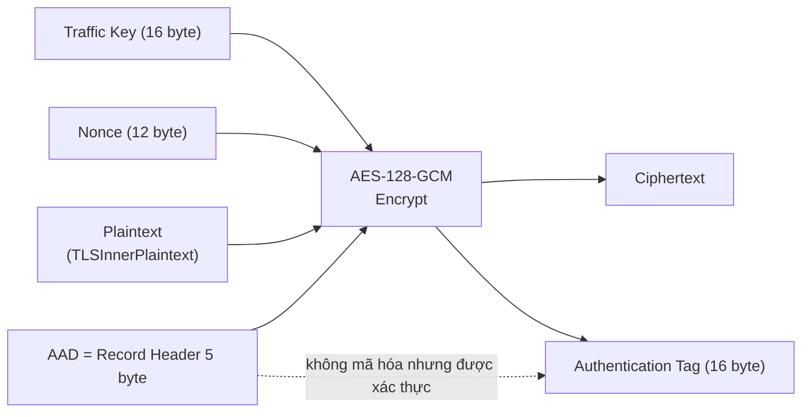

**Giải thích.** Bốn đầu vào, hai đầu ra. Đường nét đứt từ AAD đến Tag nhấn mạnh: AAD **không bị mã hóa** (không nằm trong Ciphertext) nhưng **bị ràng buộc vào Tag**.

### 8.4. AAD là gì

**AAD = Additional Authenticated Data**: dữ liệu **cần được xác thực nhưng không cần (hoặc không thể) mã hóa**.

- AAD **không** bị mã hóa.
- AAD **được đưa vào tính toán xác thực** (Tag).
- Trong TLS 1.3, **AAD là Record Header 5 byte**: `opaque_type || legacy_record_version || length` (RFC 8446 mục 5.2).

**Vì sao Header cần để rõ.** Bên nhận phải đọc `length` **trước khi giải mã** để biết cần đọc bao nhiêu byte và bắt đầu xử lý Record nào. Nếu Header cũng bị mã hóa thì không thể đọc được.

**Vì sao đổi Header làm xác thực thất bại.** Vì Header nằm trong AAD, nó góp vào Tag. Kẻ tấn công sửa một byte của Header (ví dụ đổi `length`) thì Tag tính lại ở bên nhận sẽ khác Tag đã gửi, Record bị từ chối.

### 8.5. Authentication Tag

- **Tag dùng để phát hiện chỉnh sửa** dữ liệu (Ciphertext hoặc Header).
- **Tag không phải chữ ký số.** Nó dùng chung khóa đối xứng: cả hai bên đều tạo được, nên không chứng minh với bên thứ ba rằng "người kia" đã tạo.
- **Tag không tự chứng minh danh tính server.** Nó chỉ chứng minh người gửi **biết Traffic Key** (và Key chỉ có được qua Handshake đã được xác thực).
- **Nếu Tag không hợp lệ, Record bị từ chối.** Trong TLS, đây là lỗi nghiêm trọng: gửi alert `bad_record_mac` và đóng kết nối.

| | Authentication Tag | Chữ ký số (CertificateVerify) |
|---|---|---|
| **Khóa** | Khóa đối xứng dùng chung (Traffic Key) | Cặp khóa bất đối xứng (Certificate Private/Public Key) |
| **Bảo vệ cái gì** | **Từng Record** | **Một lần** trên Transcript Handshake |
| **Chứng minh danh tính?** | **Không** | **Có** (server giữ Private Key) |
| **Bên tạo** | Hai bên (đều biết Key) | Chỉ server |

### 8.6. Mô phỏng mã hóa một HTTP Request

> **[Minh họa]** Ví dụ đơn giản hóa. Thực tế request có nhiều header hơn, có thể là HTTP/2 hoặc HTTP/3, và có thể bị chia hay gộp qua nhiều Record.

**HTTP Request:**

```
GET /api/users HTTP/1.1\r\n
Host: example.com\r\n
\r\n
```

→ **46 byte** văn bản.

**Các bước ở Client:**

1. **Đóng gói HTTP Data.** Ứng dụng giao 46 byte cho thư viện TLS.
2. **Tạo TLSInnerPlaintext:** nối 46 byte nội dung + 1 byte ContentType = `0x17` (`application_data`), không padding → **47 byte**.
3. **Tính Nonce:** Record đầu tiên của Client sau khi dùng Client Application Key có Sequence Number = 0, nên `Nonce = client_write_iv XOR 0` (xem Chương 7).
4. **Dựng Header (AAD):** độ dài `encrypted_record` = 47 (Ciphertext) + 16 (Tag) = **63 = `0x003f`**. Header: `17 03 03 00 3f`.
5. **AES-GCM mã hóa** với Key = Client Application Traffic Key, Nonce, AAD = Header, Plaintext = 47 byte. Cho **Ciphertext 47 byte**.
6. **Tạo Authentication Tag** 16 byte.
7. **Gửi TLSCiphertext Record**: Header (5 byte) + Ciphertext (47) + Tag (16) = **68 byte** trên đường truyền.

**Các bước ở Server:**

1. Đọc Header, biết `length = 63`, đọc đủ 63 byte.
2. Tính Nonce theo Sequence Number nhận (0) và `client_write_iv`.
3. Chạy giải mã AEAD với AAD = Header. **Kiểm tra Tag** trước. Sai thì từ chối (`bad_record_mac`).
4. Đúng thì có TLSInnerPlaintext. Bỏ padding, lấy byte cuối làm ContentType (`0x17` = dữ liệu ứng dụng), phần còn lại là 46 byte HTTP.
5. Chuyển HTTP Data lên tầng ứng dụng.
6. Tăng Sequence Number nhận lên 1.

### Tóm tắt Chương 8

- AES-GCM là AEAD: vừa mã hóa vừa xác thực. Input: Key, Nonce, Plaintext, AAD. Output: Ciphertext + Tag.
- Ở mức khái niệm: CTR tạo keystream để mã hóa, GHASH tham gia tính Tag.
- AAD trong TLS 1.3 là Header 5 byte: để rõ nhưng được xác thực, sửa Header là Tag sai.
- Tag phát hiện chỉnh sửa Record, nhưng không phải chữ ký số và không chứng minh danh tính server.
- Một HTTP Request, TLSInnerPlaintext và TLS Record là ba khái niệm khác nhau, không luôn tương ứng 1:1.

### Ba câu hỏi kiểm tra

1. Vì sao Record Header được để rõ nhưng vẫn được đưa vào AAD? Điều gì bảo vệ nó nếu không được mã hóa?
2. Authentication Tag khác CertificateVerify ở những điểm nào (khóa, phạm vi, mục đích)?
3. Trong ví dụ trên, vì sao độ dài trong Header là 63 chứ không phải 46 hay 47?

### Nối sang chương sau

Đã đủ mảnh ghép về từng cơ chế. Chương 9 dùng chúng để phân tích hai nguy cơ lớn: MITM và việc lộ khóa, cùng khái niệm Forward Secrecy.

---

## Chương 9. MITM và Forward Secrecy

### 9.1. MITM khi chỉ có ECDHE

Như đã mô phỏng ở [Sơ đồ 3](#sơ-đồ-3-mitm-khi-ecdhe-không-được-xác-thực) (Chương 2), nếu chỉ có ECDHE, kẻ tấn công M tạo **hai kết nối độc lập**:

- Client ↔ M, với Shared Secret A.
- M ↔ Server, với Shared Secret B.

M giải mã bằng A, đọc/sửa, mã hóa lại bằng B. **Hai đầu không có cách nào phát hiện.** Điều này cho thấy: **mã hóa mạnh không đồng nghĩa với xác thực đúng danh tính.**

### 9.2. TLS 1.3 chống MITM như thế nào

Không có một cơ chế đơn lẻ nào chống MITM. TLS 1.3 kết hợp bốn lớp, mỗi lớp bịt một lỗ:

| Lớp | Chặn cái gì | Nếu thiếu lớp này |
|---|---|---|
| **Certificate Chain Validation** (kèm hostname) | Server phải trình chứng chỉ của **đúng tên miền**, do CA tin cậy ký | M dùng chứng chỉ tự tạo hoặc của tên miền khác |
| **CertificateVerify** | Server phải **giữ Private Key** của chứng chỉ và ký trên Transcript hiện tại | M phát lại Certificate thật của server (công khai) mà không có khóa |
| **Transcript Hash** | Chữ ký **buộc vào** ClientHello, ServerHello và hai ECDHE Public Key | M thay khóa ECDHE mà chữ ký vẫn "hợp lệ" |
| **Finished** | Hai bên **cùng khóa** và **cùng thấy toàn bộ Handshake** | Thay đổi phần Handshake sau điểm ký (hoặc ép hạ cấp) không bị phát hiện |

**Cách chúng khớp nhau.** Client xác minh Certificate (danh tính hợp lệ), CertificateVerify (kẻ đang nói giữ khóa và đang ở đúng phiên), rồi Server Finished (khóa và Handshake đồng nhất). Chỉ khi cả bốn lớp qua, Client mới gửi dữ liệu ứng dụng.

### 9.3. Các trường hợp MITM vẫn có thể xảy ra

TLS bảo vệ **giữa hai TLS endpoint** với giả định về niềm tin. Khi giả định bị phá, MITM vẫn xảy ra:

| Trường hợp | Vì sao MITM vẫn thành công | Giảm thiểu thường dùng |
|---|---|---|
| **Client bỏ qua Certificate Verification** (vd tùy chọn tắt kiểm tra như `curl -k`, cờ "skip verify" trong thư viện) | Mọi kiểm tra danh tính bị tắt, M chỉ cần có chứng chỉ bất kỳ | Không bao giờ tắt kiểm tra ngoài môi trường thử nghiệm có kiểm soát |
| **Certificate Private Key bị lộ** | M ký được CertificateVerify hợp lệ với danh tính server, cho đến khi chứng chỉ bị thu hồi hoặc hết hạn | Bảo vệ khóa (HSM/KMS), thời hạn chứng chỉ ngắn, quy trình thu hồi, xoay khóa |
| **CA bị xâm phạm hoặc cấp sai chứng chỉ** | M xin được chứng chỉ "hợp lệ" cho tên miền của bạn | Certificate Transparency, CAA record, giám sát chứng chỉ mới cấp cho tên miền |
| **Root CA độc hại trong Trust Store** (malware, cấu hình độc hại) | Client tin mọi chứng chỉ do Root đó ký | Kiểm soát Trust Store, quản lý thiết bị |
| **HTTPS Inspection Proxy** (proxy doanh nghiệp, thiết bị bảo mật) | Proxy kết thúc TLS, rồi tạo kết nối TLS mới tới server, cấp chứng chỉ cho client bằng Root của tổ chức đã cài sẵn. Về mặt TLS, đây là một **endpoint hợp lệ**, không phải tấn công | Chỉ chấp nhận khi có chủ đích, minh bạch, và hiểu rằng TLS không còn "đầu cuối" |

**Phạm vi tin cậy của TLS.** TLS bảo vệ dữ liệu trên đường đi giữa hai TLS endpoint, **nếu** danh tính endpoint được xác thực đúng. Nó **không** bảo vệ khi endpoint đã bị xâm nhập (xem [Chương 12](#chương-12-những-hiểu-lầm-thường-gặp), hiểu lầm 17).

### 9.4. Forward Secrecy

**Tình huống.**

- Hôm nay kẻ tấn công **ghi lại** toàn bộ traffic mã hóa (không giải mã được).
- Một năm sau, họ **lấy được Certificate Private Key** của server.
- Câu hỏi: họ có giải mã được traffic cũ không?

**Câu trả lời với TLS 1.3 dùng ECDHE: thông thường là không.**

**Vì sao.**

- **Certificate Private Key chỉ dùng để ký** CertificateVerify (chứng minh danh tính). Nó **không** tham gia tạo Shared Secret và **không** sinh ra khóa mã hóa.
- Khóa mã hóa dữ liệu bắt nguồn từ **ECDHE Shared Secret** (Chương 6), mà Shared Secret cần **ECDHE Private Key tạm thời** của một trong hai bên.
- Các ECDHE Private Key này **đã bị xóa** sau Handshake, chưa từng được lưu hay truyền.
- Nên có Certificate Private Key cũng **không tính lại được** Shared Secret, Traffic Secret, hay Traffic Key của phiên cũ.

**Phân biệt các loại khóa và bí mật:**

| Loại | Sống bao lâu | Dùng để | Lộ thì sao |
|---|---|---|---|
| **Certificate Private Key** | Dài hạn (thời hạn chứng chỉ) | Ký CertificateVerify | Giả mạo server từ giờ về sau. **Không** giải mã được traffic cũ |
| **ECDHE Private Key** | Một Handshake, rồi bị xóa | Tính Shared Secret | Nếu lộ trong Handshake: lộ Shared Secret của **phiên đó** |
| **Shared Secret** | Chỉ trong tính toán Handshake | Đầu vào của HKDF | Lộ: tính được toàn bộ Secret và Key của phiên đó |
| **Traffic Secret** | Một key epoch | Dẫn xuất Key và IV | Lộ: giải mã được traffic của epoch đó (và tính được các epoch kế tiếp, xem Chương 10) |
| **Traffic Key** | Một key epoch | Mã hóa AES-GCM | Lộ: giải mã được traffic của epoch đó |

**Đối chiếu TLS 1.2 với trao đổi khóa RSA (đã bị loại khỏi TLS 1.3).** Ở kiểu cũ, Client mã hóa một bí mật bằng Public Key của server. Ai có Private Key của server **sau này** giải mã được bí mật đó, nên giải mã được toàn bộ traffic đã ghi lại. Forward Secrecy chính là tính chất TLS 1.3 sửa lại.

**Giới hạn của Forward Secrecy.** Forward Secrecy **không** có nghĩa là an toàn mọi lúc:

- Nếu **các bí mật của phiên** bị lộ trong lúc hoặc sau khi phiên diễn ra (dump bộ nhớ, file log khóa phiên như `SSLKEYLOGFILE`, endpoint bị xâm nhập), traffic của phiên đó bị giải mã.
- Nó chỉ bảo vệ **traffic cũ khỏi việc lộ khóa dài hạn**, không bảo vệ khỏi mọi dạng lộ bí mật.
- Các cơ chế ngoài phạm vi (resumption bằng PSK, 0-RTT) có tính chất Forward Secrecy khác.

### Sơ đồ 12. Cái gì lộ thì mất gì (Certificate Private Key và traffic cũ)

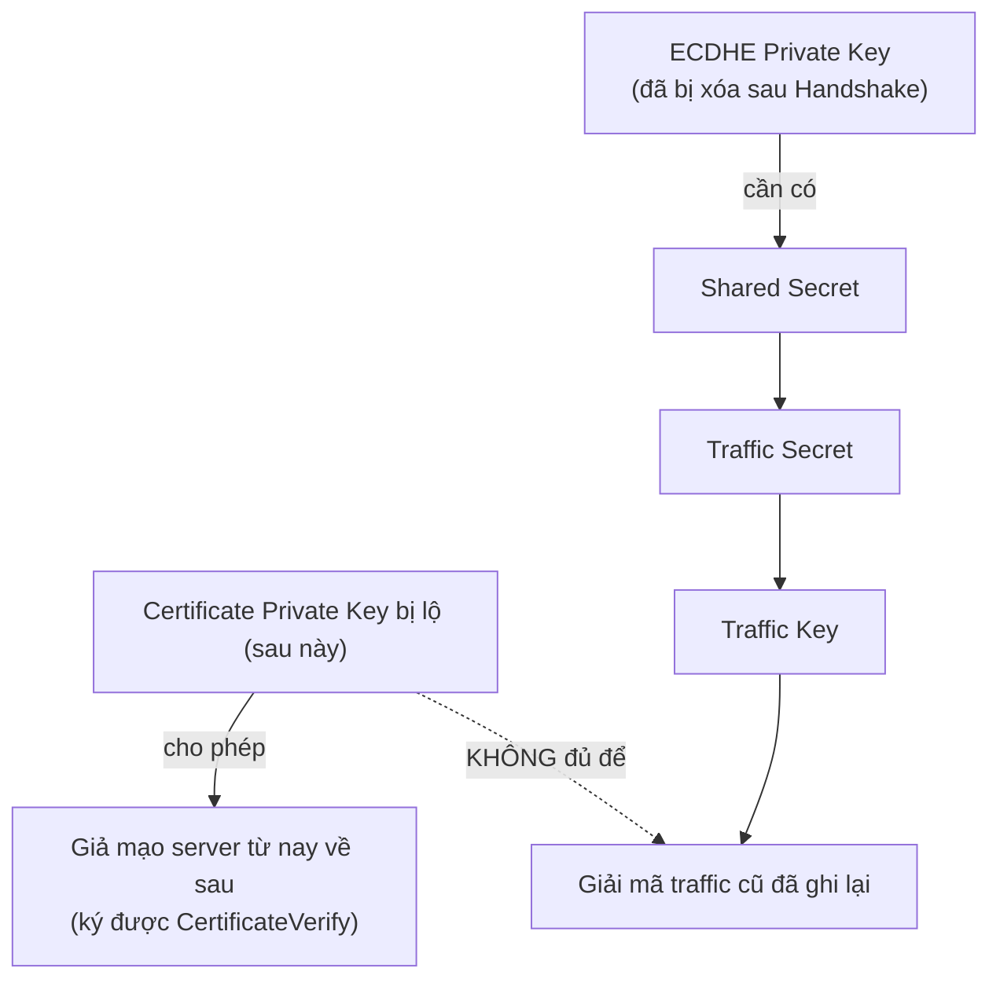

**Giải thích.** Để giải mã traffic cũ cần đi hết chuỗi ECDHE Private Key → Shared Secret → Traffic Secret → Traffic Key. Certificate Private Key **không nằm trên chuỗi này**, và ECDHE Private Key đã bị xóa, nên đường tới traffic cũ bị chặn.

### Tóm tắt Chương 9

- Chỉ ECDHE thì bị MITM. TLS 1.3 chặn bằng bốn lớp: Certificate Chain Validation, CertificateVerify, Transcript Hash, Finished.
- MITM vẫn xảy ra khi giả định niềm tin bị phá: bỏ qua kiểm tra, lộ Private Key, CA sai, Root độc hại, HTTPS Inspection Proxy.
- Forward Secrecy: lộ Certificate Private Key sau này không giải mã được traffic cũ, vì ECDHE Private Key đã bị xóa và Certificate Private Key chỉ để ký.
- Forward Secrecy không bảo vệ khi chính bí mật của phiên bị lộ.

### Ba câu hỏi kiểm tra

1. Mỗi lớp trong bốn lớp chống MITM ngăn chặn kiểu tấn công cụ thể nào? Bỏ lớp nào thì M thành công theo cách nào?
2. Vì sao lộ Certificate Private Key không giải mã được traffic TLS 1.3 đã ghi lại, nhưng lại cho phép giả mạo server trong tương lai?
3. HTTPS Inspection Proxy là tấn công hay là một TLS endpoint hợp lệ? Điều đó nói gì về phạm vi bảo vệ của TLS?

### Nối sang chương sau

Các khóa phiên đang dùng có thể tồn tại rất lâu trong kết nối dài. Chương 10 xem TLS thay khóa giữa chừng thế nào mà không Handshake lại.

---

## Chương 10. KeyUpdate

### 10.1. Tại sao cần KeyUpdate

- Một kết nối TLS có thể **tồn tại rất lâu** (kết nối dài hạn, streaming, giao tiếp giữa các dịch vụ).
- Mỗi Key chỉ nên mã hóa một **lượng dữ liệu giới hạn** (với AES-GCM, khoảng 2^24.5 Record tối đa, Chương 7).
- Sequence Number 64 bit không được quay vòng.
- Cần cách **đổi khóa** mà **không** Handshake lại từ đầu (tốn thời gian, tốn tài nguyên).

KeyUpdate là cơ chế dành riêng cho việc đó.

### 10.2. Cơ chế KeyUpdate

Thông điệp **KeyUpdate** là một thông điệp Handshake được gửi **sau khi Handshake chính đã xong**, được bảo vệ bằng khóa hiện tại. Trường `request_update` của nó nhận hai giá trị: `update_not_requested` hoặc `update_requested`.

**Dẫn xuất Secret mới:**

```
application_traffic_secret_N+1
  = HKDF-Expand-Label(application_traffic_secret_N, "traffic upd", "", Hash.length)
```

**Từ Secret mới, tính lại:**

- **Traffic Key mới** (nhãn `"key"`).
- **Static IV mới** (nhãn `"iv"`).
- **Reset Sequence Number về 0** (vì đổi Key).

**Quy tắc (RFC 8446 mục 4.6.3):**

- Sau khi **gửi** KeyUpdate, bên gửi **dùng khóa thế hệ kế tiếp** cho mọi traffic mình gửi từ đó.
- Khi **nhận** KeyUpdate, bên nhận **phải cập nhật khóa nhận** của mình.
- Nếu `update_requested`, bên nhận **phải gửi KeyUpdate của chính mình** (với `update_not_requested`) trước khi gửi Application Data kế tiếp, để cập nhật chiều ngược lại.
- Nếu hai bên cùng gửi KeyUpdate gần như đồng thời, mỗi bên sẽ phản hồi, kết quả là mỗi chiều tăng **hai thế hệ**.
- Các thế hệ cũ (Secret và khóa) **nên được xóa** sau khi đã dẫn xuất xong thế hệ mới.

### 10.3. KeyUpdate có thực hiện ECDHE mới không

**Không.**

- **Không** có ECDHE mới, **không** có Shared Secret mới, **không** có Certificate hay CertificateVerify mới, **không** có Transcript mới.
- Secret mới dẫn xuất **chỉ từ Secret hiện tại**, bằng một phép HKDF một chiều.

| | Full Handshake | KeyUpdate | Thiết lập lại kết nối |
|---|---|---|---|
| **ECDHE mới** | Có | **Không** | Có |
| **Xác thực lại server (Certificate, CertificateVerify)** | Có | **Không** | Có |
| **Nguồn khóa mới** | Shared Secret mới | **Secret hiện tại** (dẫn xuất một chiều) | Shared Secret mới |
| **Chi phí** | Cao (nhiều RTT và tính toán bất đối xứng) | **Thấp** | Cao |
| **Dùng khi** | Bắt đầu kết nối | Kết nối dài, cần đổi khóa | Kết nối đã hỏng hoặc đóng |

### 10.4. Cập nhật khóa theo từng chiều

Hai chiều truyền có Secret riêng nên **được cập nhật độc lập**.

**Ví dụ.**

- Ban đầu: Client gửi bằng khóa **A0**, Server gửi bằng khóa **B0**.
- Client gửi `KeyUpdate(update_requested)` rồi chuyển chiều gửi của mình sang **A1**.
- Server nhận, cập nhật khóa **nhận** thành A1, rồi (vì được yêu cầu) gửi `KeyUpdate(update_not_requested)` và chuyển chiều gửi của mình sang **B1**.
- Nếu Client chỉ gửi `update_not_requested`, Server **không bắt buộc** đổi chiều Server→Client: khóa **B0 giữ nguyên** cho đến khi Server tự gửi KeyUpdate.

### Sơ đồ 13. KeyUpdate

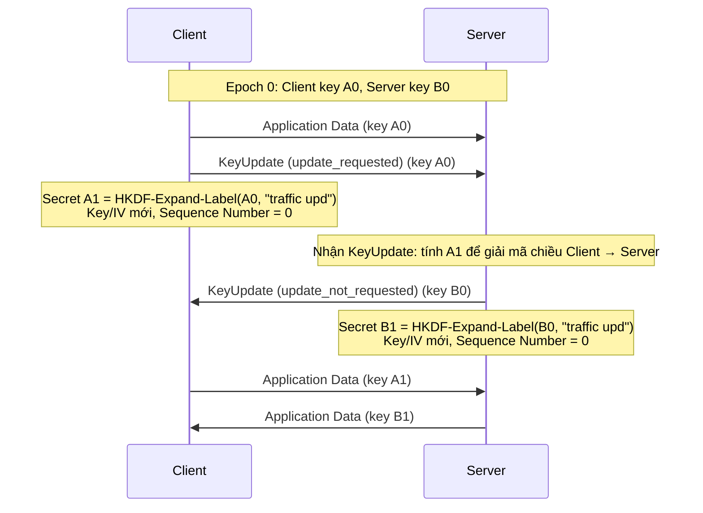

**Giải thích.** Bản thân thông điệp KeyUpdate vẫn đi bằng khóa **cũ**. Sau đó bên gửi chuyển sang khóa mới. Mỗi chiều có đường đi khóa riêng: A0 → A1 và B0 → B1.

### 10.5. KeyUpdate có phục hồi bảo mật sau khi lộ khóa không

**Không.** Cần phân biệt hai tình huống:

| Kẻ tấn công biết | Hệ quả với KeyUpdate |
|---|---|
| **Chỉ Traffic Key** của epoch N (không biết Traffic Secret) | Giải mã được traffic của epoch N. **Không** tính được Secret N+1, vì Secret N+1 dẫn xuất từ **Traffic Secret N**, không từ Traffic Key. Từ Key không suy ra Secret (đầu ra của HKDF-Expand là một chiều) |
| **Application Traffic Secret** của epoch N | **Tính được Secret N+1, N+2...** vì công thức dẫn xuất chỉ cần Secret hiện tại và nhãn công khai. KeyUpdate **không** tạo lại bí mật độc lập, nên không loại kẻ tấn công ra |

**Tóm lại:**

- Vì phép dẫn xuất là **một chiều**, kẻ tấn công biết Secret N+1 **không** suy ngược ra Secret N: traffic **cũ** hơn vẫn được bảo vệ (với điều kiện các Secret cũ đã bị xóa).
- Nhưng **tương lai** không được bảo vệ: ai biết Secret N đều tự tính được mọi Secret sau đó. KeyUpdate **không phải** cách khôi phục bảo mật sau khi bị xâm phạm. Cần Handshake mới (có ECDHE mới) để thực sự đổi bí mật gốc.

### Tóm tắt Chương 10

- KeyUpdate đổi khóa trong kết nối đang chạy, không Handshake lại. Cần vì giới hạn lượng dữ liệu mỗi Key và Sequence Number.
- `Secret N+1 = HKDF-Expand-Label(Secret N, "traffic upd", "", Hash.length)`, rồi tính lại Key, IV, reset Sequence Number.
- Không có ECDHE mới, không xác thực lại server.
- Mỗi chiều cập nhật độc lập (A0 → A1, B0 → B1).
- Lộ Traffic Secret thì lộ cả các epoch sau, KeyUpdate không phục hồi bảo mật.

### Ba câu hỏi kiểm tra

1. Vì sao KeyUpdate không cần ECDHE mới, và điều đó ảnh hưởng thế nào đến mức bảo mật so với Full Handshake?
2. Vì sao kẻ tấn công chỉ có Traffic Key (không có Traffic Secret) không tính được khóa của epoch kế tiếp?
3. Khi Client gửi `update_requested`, Server phải làm gì? Chiều Server → Client thay đổi ở thời điểm nào?

### Nối sang chương sau

Đến đây đã đủ từng mảnh. Chương 11 ghép tất cả thành một dòng thời gian duy nhất của Full Handshake.

---

## Chương 11. TLS 1.3 Full Handshake end-to-end

Đây là chương nối toàn bộ kiến thức thành một trình tự chính xác từ đầu đến cuối.

### 11.1. Trình tự 11 bước

| # | Bước | Ai gửi / tính | Chi tiết |
|---|---|---|---|
| 1 | **ClientHello** | Client → Server | Chứa `random`, danh sách cipher suite, `supported_versions` (TLS 1.3), `supported_groups`, **`key_share` (ECDHE Public Key của Client)**, `signature_algorithms`, `server_name` (SNI)... **Plaintext** |
| 2 | **ServerHello** | Server → Client | Chọn cipher suite (`TLS_AES_128_GCM_SHA256`), `supported_versions`, **`key_share` (ECDHE Public Key của Server)**. **Plaintext** |
| 3 | **ECDHE Shared Secret** | Cả hai tự tính | Client: `ECDH(c, S)`. Server: `ECDH(s, C)`. Hai kết quả bằng nhau |
| 4 | **Handshake Key Derivation** | Cả hai tự tính | Early Secret → Handshake Secret (trộn Shared Secret) → hai Handshake Traffic Secret (transcript ClientHello…ServerHello) → Key + IV cho từng chiều và Finished Key. **Từ đây mọi thông điệp Handshake đều mã hóa** |
| 5 | **EncryptedExtensions** | Server → Client | Các extension phản hồi không cần để rõ (ví dụ chọn giao thức ứng dụng ALPN). Mã hóa bằng **Server Handshake Key** |
| 6 | **Certificate** | Server → Client | Chuỗi chứng chỉ. Mã hóa bằng Server Handshake Key |
| 7 | **CertificateVerify** | Server → Client | Chữ ký trên Transcript Hash (ClientHello…Certificate). Mã hóa bằng Server Handshake Key |
| 8 | **Server Finished** | Server → Client | HMAC trên Transcript (ClientHello…CertificateVerify) bằng Server Finished Key. Mã hóa bằng Server Handshake Key |
| 9 | **Application Traffic Secret Derivation** | Cả hai tính khi đã có Server Finished | Master Secret → hai Application Traffic Secret (transcript ClientHello…Server Finished) → Key + IV |
| 10 | **Client Finished** | Client → Server | Sau khi Client xác minh xong Certificate, CertificateVerify, Server Finished. HMAC trên Transcript (ClientHello…Server Finished). Mã hóa bằng **Client Handshake Key** |
| 11 | **Application Data** | Hai chiều | Mã hóa bằng **Application Traffic Key** của từng chiều |

> **[Triển khai]** Sau Handshake, Server thường gửi thêm thông điệp `NewSessionTicket` (phục vụ Session Resumption, ngoài phạm vi) bằng Server Application Key. Ngoài ra thường có Record ChangeCipherSpec "giả" để tương thích thiết bị mạng.

### Sơ đồ 14. TLS 1.3 Full Handshake Sequence Diagram

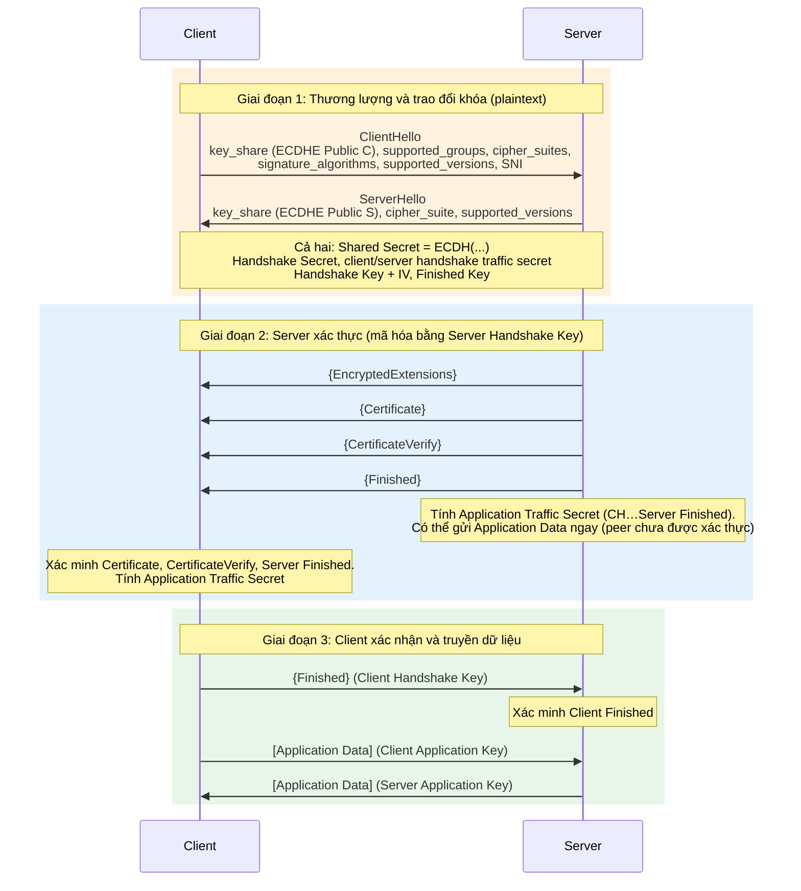

**Chú giải ký hiệu:** `{...}` = mã hóa bằng Handshake Traffic Key. `[...]` = mã hóa bằng Application Traffic Key. Không có ngoặc = plaintext.

### 11.2. Thông điệp nào được bảo vệ bằng khóa nào

| Thông điệp | Trạng thái |
|---|---|
| ClientHello, ServerHello | **Plaintext** (kể cả SNI, trừ khi dùng Encrypted Client Hello, ngoài phạm vi) |
| EncryptedExtensions, Certificate, CertificateVerify, Server Finished | **Mã hóa bằng Server Handshake Traffic Key** |
| Client Finished | **Mã hóa bằng Client Handshake Traffic Key** |
| Application Data (Client → Server) | **Client Application Traffic Key** |
| Application Data (Server → Client) | **Server Application Traffic Key** |

### 11.3. Khi nào mỗi việc xảy ra

| Sự kiện | Thời điểm |
|---|---|
| **Certificate được kiểm tra** (chuỗi, hostname, hạn, thu hồi) | Client, **sau khi nhận** thông điệp Certificate |
| **CertificateVerify được xác minh** | Client, ngay sau Certificate |
| **Server Finished được xác minh** | Client, ngay sau CertificateVerify |
| **Server được Client xác thực xong** | Khi Certificate và CertificateVerify xác minh thành công. Server Finished xác nhận thêm khóa chung và toàn vẹn Handshake |
| **Client Finished được xác minh** | Server, sau khi nhận. Lúc này Server biết Client cũng cùng khóa. Server **không** biết danh tính Client (không dùng Client Certificate) |
| **Client có thể gửi Application Data** | Sau khi **gửi Client Finished** |
| **Server có thể gửi Application Data** | **Ngay sau khi gửi Server Finished**, không cần đợi Client Finished. Lúc này Server gửi tới Client chưa được xác thực |

> **Điều không được đơn giản hóa sai.** Không đúng khi nói "Server phải đợi Client Finished mới gửi được Application Data". Theo RFC 8446, Server có thể gửi sau Server Finished, nhưng cần ý thức rằng dữ liệu đó gửi tới một peer chưa xác nhận (không nên gửi dữ liệu nhạy cảm theo cách phụ thuộc vào việc Client đã được xác thực).

### 11.4. Mỗi bên có những khóa nào, tại mỗi thời điểm

| Thời điểm | Client có | Server có |
|---|---|---|
| Client gửi ClientHello | ECDHE Private `c`, Public `C` | (chưa nhận) |
| Server nhận ClientHello, gửi ServerHello | | ECDHE Private `s`, Public `S`, Shared Secret, Handshake Secret, **cả hai** Handshake Traffic Secret, Key/IV từng chiều, Finished Key từng chiều |
| Client nhận ServerHello | Shared Secret, Handshake Secret, **cả hai** Handshake Traffic Secret, Key/IV, Finished Key | |
| Server gửi xong Server Finished | | Thêm: Master Secret, **cả hai** Application Traffic Secret, Key/IV ứng dụng |
| Client nhận và xác minh Server Finished | Thêm: Master Secret, **cả hai** Application Traffic Secret, Key/IV ứng dụng | |
| Client gửi Client Finished | Chuyển khóa **gửi** sang Client Application Key | |
| Server nhận và xác minh Client Finished | | Chuyển khóa **nhận** từ Client sang Client Application Key |

### 11.5. Bảng phân tích theo giai đoạn

| Giai đoạn | Dữ liệu trao đổi | Cơ chế mật mã | Kết quả | Mục tiêu bảo mật |
|---|---|---|---|---|
| **1. Hello + KeyShare** | ClientHello, ServerHello (ECDHE Public Key hai bên) | ECDHE (thỏa thuận khóa) | Hai bên có cùng Shared Secret | Có nguyên liệu khóa chung mà người nghe lén không biết (**chưa** xác thực) |
| **2. Dẫn xuất khóa Handshake** | Không truyền gì | HKDF Extract/Derive-Secret/Expand-Label, Transcript Hash | Handshake Traffic Secret, Key, IV, Finished Key | Handshake sau đó được **mã hóa và xác thực**; khóa gắn với Transcript |
| **3. Certificate** | Chuỗi chứng chỉ (mã hóa) | Chuỗi chữ ký CA | Client có Certificate Public Key đã tin cậy cho tên miền | Gắn danh tính với Public Key |
| **4. CertificateVerify** | Chữ ký trên Transcript Hash | Chữ ký số (Certificate Private/Public Key) | Client biết server giữ khóa và thấy cùng Handshake | **Xác thực server**, chặn MITM thay khóa |
| **5. Server Finished** | `verify_data` | HMAC (Finished Key) trên Transcript | Client xác nhận cùng khóa, Handshake không bị sửa | Key confirmation và toàn vẹn Handshake |
| **6. Dẫn xuất khóa ứng dụng** | Không truyền gì | HKDF (Master Secret, Transcript tới Server Finished) | Application Traffic Secret, Key, IV | Khóa dữ liệu **tách biệt** khóa Handshake |
| **7. Client Finished** | `verify_data` (mã hóa bằng Client Handshake Key) | HMAC (Client Finished Key) | Server xác nhận Client cùng khóa | Hoàn tất xác nhận hai chiều |
| **8. Application Data** | Record (Header + Ciphertext + Tag) | AES-GCM (Key, Nonce, AAD) | Dữ liệu ứng dụng bảo vệ | **Bí mật và toàn vẹn** từng Record |

### Tóm tắt Chương 11

- Full Handshake gồm 11 bước, ba giai đoạn: Hello và trao đổi khóa (plaintext), Server xác thực (mã hóa bằng Handshake Key), Client xác nhận và truyền dữ liệu (Application Key).
- Chỉ ClientHello và ServerHello là plaintext.
- Server có thể gửi Application Data ngay sau Server Finished (peer chưa xác thực). Client chỉ gửi Application Data sau khi gửi Client Finished.
- Mỗi bên tự tính **cả hai** chiều Secret, và dùng đúng chiều khi gửi hoặc nhận.

### Ba câu hỏi kiểm tra

1. Liệt kê các thông điệp và nói rõ chúng được bảo vệ bằng khóa nào (hoặc plaintext).
2. Vì sao Server có thể gửi Application Data trước khi nhận Client Finished, và rủi ro của việc đó là gì?
3. Tại thời điểm Client nhận ServerHello, Client đã tính được những Secret nào, và chưa tính được những gì?

### Nối sang chương sau

Với bức tranh tổng thể đã rõ, Chương 12 gom những chỗ hay hiểu sai nhất.

---

## Chương 12. Những hiểu lầm thường gặp

Mỗi hiểu lầm có bốn phần: nhận định sai, giải thích đúng, vì sao dễ nhầm, ví dụ minh họa.

### Hiểu lầm 1. "TLS dùng mã hóa bất đối xứng để mã hóa toàn bộ HTTP Data"

- **Nhận định sai:** dữ liệu HTTP được mã hóa bằng Public Key của server.
- **Giải thích đúng:** dữ liệu ứng dụng được bảo vệ bằng **mã hóa đối xứng (AES-GCM)** với Traffic Key. Bất đối xứng chỉ dùng cho thỏa thuận khóa (ECDHE) và chữ ký số (xác thực).
- **Vì sao dễ nhầm:** các mô tả sơ lược "Public Key mã hóa, Private Key giải mã" bị áp dụng cho cả TLS.
- **Ví dụ:** ECDHE không mã hóa gì cả, nó chỉ cho hai bên cùng ra một Shared Secret. Chữ ký CertificateVerify không che giấu dữ liệu nào.

### Hiểu lầm 2. "ECDHE Shared Secret được Server gửi cho Client"

- **Nhận định sai:** có một bước Server gửi bí mật chung cho Client.
- **Giải thích đúng:** chỉ hai ECDHE **Public Key** đi qua mạng. Mỗi bên **tự tính** Shared Secret từ Private Key của mình và Public Key của bên kia.
- **Vì sao dễ nhầm:** từ "trao đổi khóa" (key exchange) gợi ý có khóa được trao đi.
- **Ví dụ:** trong ví dụ Diffie-Hellman số nhỏ (Chương 2), qua mạng chỉ có 8 và 19, còn Shared Secret 2 do hai bên tự tính.

### Hiểu lầm 3. "ECDHE tự xác thực Server"

- **Nhận định sai:** đã có ECDHE thì biết đang nói chuyện đúng server.
- **Giải thích đúng:** ECDHE không gắn khóa với danh tính nào, nên không thể phân biệt server thật và kẻ chen giữa. Xác thực đến từ Certificate, CertificateVerify, Finished.
- **Vì sao dễ nhầm:** thấy kênh đã được mã hóa nên tin là đang an toàn.
- **Ví dụ:** [Sơ đồ 3](#sơ-đồ-3-mitm-khi-ecdhe-không-được-xác-thực): M tạo hai kết nối ECDHE độc lập.

### Hiểu lầm 4. "Certificate Public Key được dùng để giải mã HTTP Data"

- **Nhận định sai:** dữ liệu HTTP mã hóa bằng Public Key trong Certificate.
- **Giải thích đúng:** trong TLS 1.3, Certificate Public Key chỉ dùng để **xác minh chữ ký** CertificateVerify. Nó không tham gia mã hóa hay giải mã dữ liệu.
- **Vì sao dễ nhầm:** chứng chỉ chứa "Public Key" nên bị nghĩ đó là khóa mã hóa.
- **Ví dụ:** ECDSA P-256 chỉ làm được chữ ký, không dùng để mã hóa gì.

### Hiểu lầm 5. "Certificate Private Key tạo ra ECDHE Shared Secret"

- **Nhận định sai:** khóa của chứng chỉ sinh ra khóa phiên.
- **Giải thích đúng:** Shared Secret sinh từ **ECDHE Private Key tạm thời** của hai bên. Certificate Private Key chỉ để **ký**.
- **Vì sao dễ nhầm:** đều là "Private Key của server".
- **Ví dụ:** vì hai loại khóa độc lập nên lộ Certificate Private Key không làm lộ traffic cũ (Forward Secrecy, Chương 9).

### Hiểu lầm 6. "CertificateVerify và Finished giống nhau"

- **Nhận định sai:** cả hai đều "xác nhận Handshake".
- **Giải thích đúng:** CertificateVerify là **chữ ký số** chứng minh server giữ Private Key. Finished là **HMAC** chứng minh khóa chung và toàn vẹn Handshake. Khóa, thuật toán và mục đích khác nhau (bảng so sánh ở Chương 5).
- **Vì sao dễ nhầm:** cả hai đều tính trên Transcript Hash.
- **Ví dụ:** M có thể tạo Finished hợp lệ cho đoạn kết nối của mình (biết khóa đoạn đó) nhưng không thể tạo CertificateVerify hợp lệ.

### Hiểu lầm 7. "Transcript Hash là Hash của toàn bộ traffic ứng dụng"

- **Nhận định sai:** Transcript tăng dần theo mọi dữ liệu truyền.
- **Giải thích đúng:** Transcript chỉ gồm các **thông điệp Handshake** theo thứ tự, và dùng ở các thời điểm xác định. Không chứa dữ liệu ứng dụng.
- **Vì sao dễ nhầm:** chữ "transcript" gợi tới bản ghi toàn bộ cuộc hội thoại.
- **Ví dụ:** Transcript cho Application Traffic Secret dừng ở Server Finished, trước mọi Application Data.

### Hiểu lầm 8. "Client và Server gửi Traffic Key cho nhau"

- **Nhận định sai:** một bên tạo khóa phiên rồi gửi cho bên kia.
- **Giải thích đúng:** Traffic Key **không bao giờ truyền**. Mỗi bên tự dẫn xuất bằng HKDF từ cùng Shared Secret và cùng Transcript, nên ra cùng kết quả.
- **Vì sao dễ nhầm:** các mô hình cũ (như RSA key exchange) thực sự gửi bí mật đã mã hóa.
- **Ví dụ:** cùng input cho HKDF thì luôn cùng output, hai bên không cần trao đổi gì thêm.

### Hiểu lầm 9. "Traffic Secret và Traffic Key là một"

- **Nhận định sai:** hai tên cho cùng một giá trị.
- **Giải thích đúng:** Traffic Secret (32 byte) là **gốc**. Traffic Key (16 byte) và Static IV (12 byte) là hai giá trị dẫn xuất từ nó bằng nhãn `"key"` và `"iv"`.
- **Vì sao dễ nhầm:** tên gọi gần giống nhau.
- **Ví dụ:** KeyUpdate dẫn xuất **Secret** mới, rồi mới tính Key và IV mới từ Secret mới.

### Hiểu lầm 10. "Static IV và Nonce là một"

- **Nhận định sai:** IV chính là Nonce dùng cho mọi Record.
- **Giải thích đúng:** Static IV là gốc cố định trong một epoch. **Nonce của từng Record** = Static IV XOR Sequence Number đã đệm, nên mỗi Record một Nonce khác.
- **Vì sao dễ nhầm:** trong một số giao thức khác IV chính là Nonce.
- **Ví dụ:** bảng ở Chương 7: Sequence 0, 1, 2 cho ba Nonce khác nhau từ cùng một Static IV.

### Hiểu lầm 11. "Nonce phải được giữ bí mật"

- **Nhận định sai:** lộ Nonce là lộ khóa.
- **Giải thích đúng:** Nonce **không cần bí mật**, nhưng phải **duy nhất cho mỗi Key**. Điều nguy hiểm là **tái sử dụng**, không phải bị biết.
- **Vì sao dễ nhầm:** gộp chung "giá trị đặc biệt" với "bí mật".
- **Ví dụ:** Nonce suy ra được từ Sequence Number mà người ngoài có thể đoán, vẫn an toàn vì Key bí mật.

### Hiểu lầm 12. "Mỗi Record cần Traffic Key mới"

- **Nhận định sai:** TLS đổi khóa theo từng Record.
- **Giải thích đúng:** một Key dùng cho nhiều Record trong một epoch. Cái đổi theo từng Record là **Nonce**. Key chỉ đổi khi KeyUpdate hoặc Handshake mới.
- **Vì sao dễ nhầm:** nghĩ rằng mỗi lần mã hóa cần "chìa khóa mới" mới an toàn.
- **Ví dụ:** AES-GCM mã hóa được khoảng 2^24.5 Record trên một Key trước khi cần đổi.

### Hiểu lầm 13. "AES-GCM chỉ mã hóa mà không xác thực"

- **Nhận định sai:** cần thêm một MAC riêng để chống sửa dữ liệu.
- **Giải thích đúng:** AES-GCM là **AEAD**, tự cung cấp xác thực bằng Authentication Tag.
- **Vì sao dễ nhầm:** các chế độ mã hóa cổ điển (như CBC thuần) không có xác thực.
- **Ví dụ:** sửa một bit của Ciphertext, bên nhận tính Tag lại sẽ khác và từ chối Record.

### Hiểu lầm 14. "Authentication Tag xác thực danh tính Server"

- **Nhận định sai:** Tag hợp lệ nghĩa là đúng server.
- **Giải thích đúng:** Tag chứng minh người gửi **biết Traffic Key** và dữ liệu nguyên vẹn. Danh tính được xác thực ở Handshake bằng Certificate và CertificateVerify.
- **Vì sao dễ nhầm:** Tag có chữ "Authentication".
- **Ví dụ:** trong MITM không xác thực, M cũng tạo Tag hợp lệ cho kết nối của chính nó.

### Hiểu lầm 15. "KeyUpdate thực hiện lại ECDHE"

- **Nhận định sai:** KeyUpdate là một mini-Handshake.
- **Giải thích đúng:** KeyUpdate chỉ dẫn xuất Secret mới **từ Secret hiện tại** bằng HKDF một chiều. Không có ECDHE mới, không có xác thực lại.
- **Vì sao dễ nhầm:** tên "update key" gợi ý đổi hẳn khóa gốc.
- **Ví dụ:** ai biết Traffic Secret N thì tự tính ra N+1.

### Hiểu lầm 16. "Lộ Certificate Private Key luôn giải mã được mọi traffic cũ"

- **Nhận định sai:** có khóa của server là đọc được traffic đã ghi lại.
- **Giải thích đúng:** với TLS 1.3 dùng ECDHE, **không**. Đúng với TLS 1.2 dùng trao đổi khóa RSA (đã bị loại bỏ khỏi TLS 1.3).
- **Vì sao dễ nhầm:** hiểu từ mô hình cũ.
- **Ví dụ:** kịch bản ở mục 9.4: ghi traffic hôm nay, lấy khóa một năm sau, vẫn không giải mã được.

### Hiểu lầm 17. "HTTPS bảo vệ dữ liệu ngay cả khi endpoint đã bị xâm nhập"

- **Nhận định sai:** có HTTPS là dữ liệu an toàn dù máy bị chiếm.
- **Giải thích đúng:** TLS bảo vệ **trên đường truyền giữa hai endpoint**. Nếu endpoint (trình duyệt, server, ứng dụng) bị xâm nhập, kẻ tấn công đọc dữ liệu ở dạng đã giải mã hoặc lấy khóa phiên.
- **Vì sao dễ nhầm:** "an toàn" bị hiểu theo nghĩa rộng.
- **Ví dụ:** malware đọc nội dung form trước khi trình duyệt mã hóa, hay một lỗ hổng XSS trên trang HTTPS.

### Hiểu lầm 18. "TLS 1.3 mã hóa toàn bộ metadata mạng"

- **Nhận định sai:** người quan sát mạng không thấy gì về kết nối.
- **Giải thích đúng:** TLS 1.3 mã hóa Handshake sau ServerHello và giấu ContentType, nhưng người quan sát vẫn thấy **IP và port nguồn/đích**, **SNI** (trong ClientHello, trừ khi dùng Encrypted Client Hello), **kích thước và thời điểm của Record**. Truy vấn DNS là một kênh riêng.
- **Vì sao dễ nhầm:** quảng bá "TLS 1.3 mã hóa nhiều hơn" bị hiểu thành "mã hóa tất cả".
- **Ví dụ:** nhà mạng vẫn biết bạn truy cập `example.com` (qua SNI hoặc DNS) và lượng dữ liệu trao đổi.

---

## Chương 13. Ứng dụng trong Infrastructure (phần mở rộng)

> Chương này phục vụ mở rộng kiến thức và Q&A, không bắt buộc đưa vào bài thuyết trình chính.

### 13.1. TLS Termination tại Load Balancer

**Mô hình:** `Client → HTTPS Load Balancer → Backend`.

- **TLS kết thúc ở đâu?** Tại Load Balancer. Handshake TLS 1.3 diễn ra giữa Client và Load Balancer.
- **Ai giữ Certificate Private Key?** Load Balancer (hoặc dịch vụ quản lý khóa mà nó dùng, ví dụ KMS/HSM hoặc kho chứng chỉ của nhà cung cấp). Backend thường **không** giữ khóa này.
- **Dữ liệu còn mã hóa sau Load Balancer không?** Tùy cấu hình. Nếu LB chuyển tiếp bằng HTTP thường thì **plaintext** trên đoạn LB → Backend. Nếu LB mở một kết nối TLS **mới** tới Backend thì đoạn đó được mã hóa lại (**re-encryption**), và đây là một phiên TLS **độc lập** với phiên Client ↔ LB.
- **Khi nào cần TLS từ LB tới Backend?** Khi mạng nội bộ không được tin cậy hoàn toàn, khi có yêu cầu tuân thủ (mã hóa mọi đoạn), khi theo mô hình zero-trust, hoặc cần mTLS giữa các dịch vụ.

### Sơ đồ 15. TLS Termination tại Load Balancer

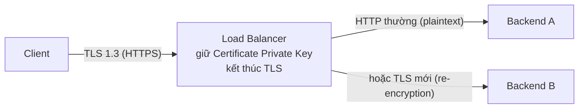

**Giải thích.** Có hai phiên bảo vệ riêng biệt: Client ↔ LB (TLS 1.3 như các chương trước) và LB ↔ Backend (không có, hoặc một phiên TLS khác với Handshake và khóa riêng). Chứng chỉ mà Client thấy là chứng chỉ của LB.

**Hệ quả cho việc đọc thông tin kết nối.** Vì TLS kết thúc ở LB, Backend không thấy IP của Client (chỉ thấy IP của LB) và không thấy chứng chỉ của Client nếu có. Thông tin này phải được LB **chuyển tiếp qua HTTP header** (ví dụ `X-Forwarded-For`), và Backend phải **chỉ tin header đến từ LB** thật.

### 13.2. TLS Passthrough

LB **không kết thúc TLS**, chỉ chuyển tiếp các byte TCP tới Backend. Handshake TLS diễn ra **giữa Client và Backend**.

| | Termination | Re-encryption | Passthrough |
|---|---|---|---|
| **TLS kết thúc ở** | LB | LB, rồi Backend (hai phiên) | **Backend** |
| **Ai giữ Certificate Private Key** | LB | LB và Backend | **Backend** |
| **LB có đọc được HTTP không** | Có | Có | **Không** (chỉ thấy luồng byte, và thường là SNI) |
| **Định tuyến theo URL/header, WAF ở LB** | Có | Có | Không |
| **Chứng chỉ Client đến thẳng Backend** | Không (LB nhận) | Không | **Có** (mTLS đầu cuối) |
| **IP Client ở Backend** | Qua header | Qua header | Phụ thuộc loại LB và cấu hình mạng |
| **Quản lý chứng chỉ** | Tập trung ở LB | Ở cả hai nơi | Ở từng Backend |

### 13.3. TLS và Kubernetes

Luồng phổ biến: `Client → External Load Balancer → Ingress Controller / Gateway → Service → Pod`.

- **External Load Balancer:** thường do nhà cung cấp cloud tạo ra, có thể là L4 (chuyển tiếp TCP, không đọc TLS) hoặc L7 (kết thúc TLS).
- **Ingress Controller** hoặc **Gateway API:** thành phần trong cluster. Thường **kết thúc TLS** bằng chứng chỉ lưu trong Secret (hoặc do công cụ quản lý chứng chỉ tự động cấp và gia hạn).
- **Gateway API** mô tả rõ chế độ ở mỗi listener: `Terminate` (kết thúc TLS tại Gateway) hoặc `Passthrough` (chuyển tiếp TLS nguyên vẹn tới backend).
- **Backend Service/Pod:** có thể nhận HTTP thường (sau Termination) hoặc TLS (re-encryption hoặc Passthrough).

**Các kiến trúc thường gặp:**

| Kiến trúc | TLS kết thúc ở | Đoạn trong cluster |
|---|---|---|
| L7 LB của cloud → Pod | LB | Plaintext (hoặc TLS mới nếu cấu hình) |
| L4 LB → Ingress → Pod | Ingress Controller | Plaintext hoặc re-encryption |
| L4 LB → Ingress ở chế độ Passthrough → Pod | Pod | TLS đầu cuối |
| Có Service Mesh | Mỗi điểm (sidecar) | mTLS giữa các Pod do mesh quản lý (ngoài phạm vi) |

**Lưu ý chung khi LB L4 đứng trước Ingress.** Chế độ chuyển tiếp lưu lượng (ví dụ `externalTrafficPolicy` của Service trong Kubernetes) ảnh hưởng đến việc IP của Client có được giữ nguyên tới Pod hay bị thay bằng IP của Node. Đây là một vấn đề vận hành thường gặp khi cần lấy IP thật.

### 13.4. Certificate Rotation

- **Thay Certificate:** cấp chứng chỉ mới (cùng hoặc khác khóa), nạp vào LB/Ingress/Backend.
- **Thay Certificate Private Key:** khi nghi lộ khóa hoặc theo chính sách. Chứng chỉ mới phải ứng với khóa mới.
- **Ảnh hưởng tới kết nối hiện tại:** các kết nối **đang mở** tiếp tục dùng khóa phiên đã thỏa thuận (độc lập với chứng chỉ), nên **không bị ngắt**. Chỉ các **Handshake mới** dùng chứng chỉ mới.
- **Nên làm:** nạp chứng chỉ mới mà không cần khởi động lại dịch vụ (nếu thành phần hỗ trợ nạp lại), giữ thời gian chồng lấn, theo dõi ngày hết hạn.

**Phân biệt Certificate Rotation và KeyUpdate:**

| | Certificate Rotation | KeyUpdate |
|---|---|---|
| **Thay cái gì** | Chứng chỉ (và có thể cả Private Key dài hạn) của server | Traffic Key và IV trong **một kết nối đang chạy** |
| **Thời điểm** | Theo vòng đời chứng chỉ (ngày, tháng) | Trong kết nối, theo lượng dữ liệu hoặc thời gian |
| **Ảnh hưởng kết nối đang mở** | Không | Có (đổi khóa của kết nối đó) |
| **Liên quan Handshake** | Chỉ ảnh hưởng Handshake **mới** | Không có Handshake |

### 13.5. Các vấn đề vận hành thường gặp

| Vấn đề | Triệu chứng thường thấy | Hướng kiểm tra |
|---|---|---|
| **Certificate Expiration** | Client báo chứng chỉ hết hạn | Kiểm tra `notAfter`, theo dõi sớm, tự động hóa gia hạn |
| **Hostname Mismatch** | Báo tên không khớp | SAN có chứa đúng tên miền truy cập không |
| **Missing Intermediate CA** | Một số client lỗi, số khác không (do client tự cache được Intermediate) | Server có gửi đủ chuỗi (leaf + intermediate) chưa |
| **Untrusted Root CA** | Lỗi "không tin cậy" ở môi trường cụ thể | Trust Store của client có Root đó chưa |
| **TLS Version Mismatch** | Handshake thất bại sớm | Phiên bản tối thiểu/tối đa hai bên hỗ trợ |
| **Cipher Suite Mismatch** | Handshake thất bại, không có cipher suite chung | Danh sách cipher suite hai bên |
| **SNI** | Nhận chứng chỉ mặc định, sai tên miền | Client có gửi SNI không, server có cấu hình chứng chỉ theo SNI không |
| **Lỗi Handshake chung** | Kết nối bị đóng hoặc nhận alert | Chạy công cụ chẩn đoán, đọc alert và log hai phía |

**Công cụ chẩn đoán thường dùng:**

```bash
# Xem chuỗi chứng chỉ và thông tin Handshake, bắt buộc TLS 1.3, có SNI
openssl s_client -connect example.com:443 -servername example.com -tls1_3 -showcerts

# Xem nhanh thời hạn của chứng chỉ server trả về
echo | openssl s_client -connect example.com:443 -servername example.com 2>/dev/null | openssl x509 -noout -dates -subject -issuer
```

---

## Tổng kết

**Mạch kiến thức xuyên suốt:**

1. **Vấn đề:** dữ liệu qua mạng có thể bị nghe lén, sửa, và server có thể bị giả mạo. TLS nhắm tới bí mật, toàn vẹn, xác thực.
2. **Phân công cơ chế:** ECDHE thỏa thuận khóa. Certificate và chữ ký số xác thực server. HMAC (Finished) xác nhận khóa và toàn vẹn Handshake. HKDF dẫn xuất khóa. AES-GCM bảo vệ dữ liệu.
3. **ECDHE** cho hai bên cùng một Shared Secret mà không truyền nó, nhưng **không xác thực** nên đứng một mình bị MITM.
4. **Certificate** gắn Public Key với danh tính. **CertificateVerify** (chữ ký trên Transcript Hash) chứng minh server giữ Private Key và đang ở đúng Handshake này, nên chặn MITM thay khóa.
5. **Finished** (HMAC) xác nhận hai bên cùng khóa và toàn bộ Handshake không bị sửa.
6. **Key Schedule** (Early, Handshake, Master Secret, kèm Transcript Hash) dẫn xuất các Traffic Secret theo từng giai đoạn và từng chiều. Mỗi Secret cho một cặp **Traffic Key (16 byte) + Static IV (12 byte)**.
7. Mỗi **TLS Record** được mã hóa bằng **AES-GCM**: Key cố định trong epoch, **Nonce = Static IV XOR Sequence Number** thay đổi theo Record, **AAD = Header 5 byte**, kết quả là Ciphertext + Tag.
8. **Forward Secrecy** nhờ ECDHE tạm thời: lộ Certificate Private Key về sau không giải mã được traffic cũ. **KeyUpdate** đổi khóa trong kết nối dài bằng dẫn xuất một chiều, không có ECDHE mới.
9. **Giới hạn của TLS:** bảo vệ trên đường truyền giữa các TLS endpoint, trong giả định niềm tin vào CA và Trust Store, không bảo vệ endpoint bị xâm nhập.

**Tài liệu có 15 sơ đồ Mermaid** (14 sơ đồ theo yêu cầu cộng thêm Sơ đồ 12 về hệ quả của việc lộ khóa).

---

## Câu hỏi kiểm tra tổng hợp

1. Vì sao TLS 1.3 cần cả ECDHE, Certificate, CertificateVerify và Finished? Bỏ từng cái sẽ mất đi điều gì?
2. Mô tả đường đi của một bí mật từ ECDHE Private Key đến một Traffic Key cụ thể (qua những Secret nào).
3. Phân biệt Certificate Public Key và ECDHE Public Key: ai tạo, sống bao lâu, dùng để làm gì.
4. Giải thích vì sao Nonce của mỗi Record khác nhau mà cả hai bên vẫn tính ra giống nhau, trong khi Nonce không cần bí mật.
5. Vì sao Header của Record được để rõ nhưng sửa nó vẫn bị phát hiện?
6. Server có thể gửi Application Data vào thời điểm nào? Client thì sao? Rủi ro của việc Server gửi sớm là gì?
7. Kẻ tấn công ghi lại traffic hôm nay và lấy được Certificate Private Key một năm sau. Điều gì có thể và không thể làm?
8. Phân biệt Full Handshake, KeyUpdate và Certificate Rotation.
9. Vì sao HTTPS Inspection Proxy không phải là tấn công vào TLS, nhưng lại phá tính "đầu cuối"?
10. Kết thúc TLS tại Load Balancer thay đổi những gì về nơi giữ Certificate Private Key, dữ liệu sau LB và thông tin mà Backend nhìn thấy?

---

## Thuật ngữ

| Thuật ngữ (Anh) | Tiếng Việt / giải thích ngắn |
|---|---|
| **AAD** (Additional Authenticated Data) | Dữ liệu bổ sung được xác thực nhưng không mã hóa. Trong TLS 1.3 là Record Header 5 byte |
| **AEAD** (Authenticated Encryption with Associated Data) | Mã hóa có xác thực kèm dữ liệu liên quan. AES-GCM là một AEAD |
| **AES-GCM** | Thuật toán AEAD dựa trên AES ở chế độ Galois/Counter |
| **Application Traffic Secret** | Secret dẫn xuất từ Master Secret, gốc cho khóa bảo vệ dữ liệu ứng dụng |
| **Authentication Tag** | Giá trị 16 byte do AES-GCM tạo ra để phát hiện chỉnh sửa Ciphertext và AAD |
| **Block Cipher** | Thuật toán mã hóa theo khối cố định (AES: 128 bit) |
| **CA** (Certification Authority) | Tổ chức cấp và ký chứng chỉ |
| **Certificate** | Chứng chỉ X.509 gắn Public Key với danh tính, do CA ký |
| **Certificate Chain** | Chuỗi chứng chỉ từ leaf qua Intermediate tới Root |
| **CertificateVerify** | Thông điệp chứa chữ ký số của server trên Transcript, chứng minh sở hữu Private Key |
| **Ciphertext** | Dữ liệu sau khi mã hóa |
| **Confidentiality** | Tính bí mật |
| **Derive-Secret** | Hàm TLS 1.3 dẫn xuất Secret từ Secret khác, nhãn và Transcript Hash |
| **Digital Signature** | Chữ ký số: ký bằng Private Key, xác minh bằng Public Key |
| **ECDHE** (Elliptic Curve Diffie-Hellman Ephemeral) | Thỏa thuận khóa Diffie-Hellman trên đường cong elliptic với khóa tạm thời |
| **Ephemeral** | Tạm thời, chỉ dùng cho một lần/kết nối |
| **Finished** | Thông điệp chứa HMAC trên Transcript, xác nhận khóa và toàn vẹn Handshake |
| **Forward Secrecy** | Tính chất: lộ khóa dài hạn về sau không làm lộ traffic cũ |
| **Handshake** | Quá trình thương lượng và thiết lập khóa, xác thực |
| **Handshake Traffic Secret** | Secret gốc cho khóa bảo vệ thông điệp Handshake |
| **HKDF** | KDF dựa trên HMAC (RFC 5869) |
| **HKDF-Expand-Label** | Biến thể HKDF-Expand của TLS 1.3 với nhãn có tiền tố `"tls13 "` |
| **HMAC** | Mã xác thực thông điệp dùng khóa bí mật và hàm Hash |
| **Integrity** | Tính toàn vẹn |
| **KeyUpdate** | Cơ chế đổi Traffic Key trong kết nối đang chạy |
| **Key Agreement** | Thỏa thuận khóa: hai bên cùng tính ra một bí mật |
| **Key Schedule** | Chuỗi các bước dẫn xuất khóa của TLS 1.3 |
| **Master Secret** | Secret cuối của Key Schedule, gốc cho Application Traffic Secret |
| **MITM** (Man-in-the-Middle) | Kẻ tấn công chen giữa hai bên |
| **Nonce** | Giá trị dùng một lần cho mỗi Key; ở TLS là `Static IV XOR Sequence Number` |
| **Plaintext** | Dữ liệu chưa mã hóa |
| **Private Key / Public Key** | Khóa bí mật / khóa công khai của một cặp khóa bất đối xứng |
| **Revocation** | Thu hồi chứng chỉ |
| **Sequence Number** | Bộ đếm 64 bit của Record, riêng mỗi chiều |
| **Shared Secret** | Kết quả thô của ECDHE, đầu vào của HKDF |
| **SNI** (Server Name Indication) | Extension ClientHello báo tên miền muốn truy cập |
| **Static IV** | IV cố định dẫn xuất từ Traffic Secret, gốc để tính Nonce |
| **Trust Store** | Tập các Root CA được tin cậy |
| **Traffic Key** | Khóa AES dẫn xuất từ Traffic Secret |
| **Traffic Secret** | Secret gốc để dẫn xuất Traffic Key và Static IV |
| **Transcript Hash** | Hash của các thông điệp Handshake theo thứ tự |
| **TLS Record** | Đơn vị dữ liệu của Record Layer |
| **TLSInnerPlaintext** | Nội dung + ContentType + padding, trước khi mã hóa thành Record |

---

## Tài liệu tham khảo

- **RFC 8446** – The Transport Layer Security (TLS) Protocol Version 1.3. https://www.rfc-editor.org/rfc/rfc8446
- **RFC 5869** – HMAC-based Extract-and-Expand Key Derivation Function (HKDF). https://www.rfc-editor.org/rfc/rfc5869
- **RFC 5116** – An Interface and Algorithms for Authenticated Encryption. https://www.rfc-editor.org/rfc/rfc5116
- **RFC 7748** – Elliptic Curves for Security (X25519, X448). https://www.rfc-editor.org/rfc/rfc7748
- **NIST SP 800-38D** – Recommendation for Block Cipher Modes of Operation: Galois/Counter Mode (GCM) and GMAC. https://csrc.nist.gov/pubs/sp/800/38/d/final

---

## Phụ lục A. Đối chiếu với RFC 8446

Các điểm dưới đây có đối chiếu trực tiếp với văn bản RFC 8446 bằng cách đọc nguồn tại thời điểm viết, và các điểm còn lại chỉ dựa trên kiến thức có sẵn.

### A.1. Đã đối chiếu với văn bản RFC

| Nội dung trong tài liệu | Mục RFC 8446 |
|---|---|
| Công thức Early/Handshake/Master Secret, bước `derived`, giá trị 0 mặc định, các nhãn `c hs traffic`, `s hs traffic`, `c ap traffic`, `s ap traffic` và phạm vi Transcript | 7.1 |
| Định nghĩa HKDF-Expand-Label, HkdfLabel (tiền tố `"tls13 "`), Derive-Secret | 7.1 |
| `application_traffic_secret_N+1 = HKDF-Expand-Label(..., "traffic upd", "", Hash.length)` | 7.2 |
| Dẫn xuất Key và IV bằng nhãn `"key"`, `"iv"` | 7.3 |
| Dữ liệu ký của CertificateVerify (64 byte `0x20`, context string, byte `0x00`, Transcript Hash); context string server và client; RSA phải dùng RSASSA-PSS | 4.4.3 |
| `finished_key`, `verify_data` bằng HMAC; Base Key và Handshake Context của Server Finished và Client Finished | 4.4.4 |
| Hành vi KeyUpdate (`update_requested`, bên gửi dùng khóa thế hệ mới, bên nhận phải cập nhật, hai bên cùng gửi thì tăng hai thế hệ) | 4.6.3 |
| TLSCiphertext (`opaque_type` 23, `legacy_record_version` `0x0303`, `length`), AAD, cấu trúc TLSInnerPlaintext | 5.2 |
| Nonce: Sequence Number 64 bit đệm trái số 0 rồi XOR với write IV; Sequence Number về 0 khi đổi khóa; tách riêng đọc và ghi | 5.3 |
| Giới hạn AES-GCM khoảng 2^24.5 Record kích thước tối đa với biên an toàn khoảng 2^-57 | 5.5 |
| Thuật toán bắt buộc: `TLS_AES_128_GCM_SHA256`; chữ ký `rsa_pkcs1_sha256`, `rsa_pss_rsae_sha256`, `ecdsa_secp256r1_sha256`; nhóm `secp256r1` (MUST), X25519 (SHOULD) | 9.1 |
| Server có thể gửi Application Data trước khi nhận xác thực của Client (peer chưa được xác thực) | 2 và 4.4.4 |
| OCSP của server nằm trong extension của CertificateEntry; chứng chỉ trust anchor có thể được bỏ khỏi chuỗi | 4.4.2.1 và 4.4.2 |

### A.2. Chưa đối chiếu trực tiếp (dựa trên kiến thức, nên kiểm tra thêm trước khi trích dẫn)

- Chi tiết thành phần Transcript Hash: gồm cả header thông điệp Handshake, loại trừ header Record Layer, và quy tắc đặc biệt với HelloRetryRequest (mục 4.4.1).
- Giới hạn kích thước Record (2^14 byte nội dung), và quy tắc Sequence Number không được quay vòng (mục 5.1, 5.3).
- Tên alert `bad_record_mac` khi AEAD thất bại; việc Record ChangeCipherSpec tương thích thiết bị mạng không nằm trong Transcript (mục 5.4 và phụ lục D).
- Khuyến nghị xóa Secret cũ sau KeyUpdate (mục 7.2).
- Kích thước khóa và IV của `TLS_AES_128_GCM_SHA256` (khóa 16 byte, IV 12 byte, Tag 16 byte) và kích thước khóa X25519 (32 byte) theo RFC 5116 và RFC 7748.
- Hệ quả khi tái sử dụng (Key, Nonce) của AES-GCM (NIST SP 800-38D).
- Nội dung về CRL, OCSP, Certificate Transparency, CAA, Encrypted Client Hello và các khuyến nghị vận hành ở Chương 3, 9 và 13 (ngoài RFC 8446).
- Chương 13 mang tính khái quát, hành vi cụ thể của từng sản phẩm Load Balancer, Ingress, Gateway cần xem tài liệu của sản phẩm đó.
